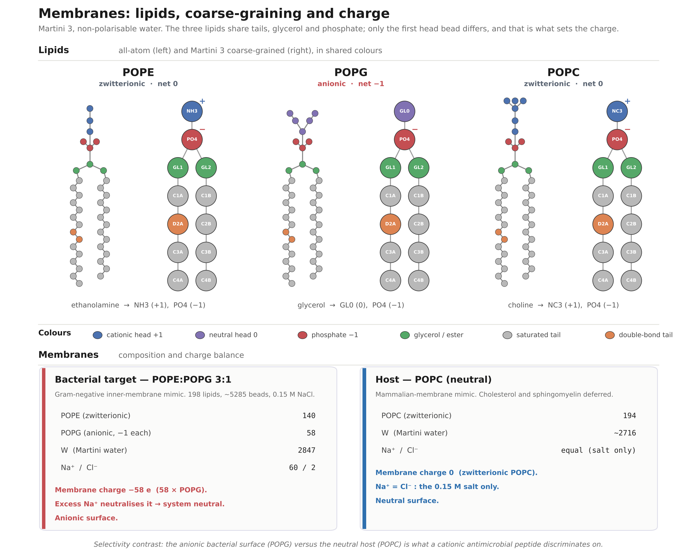
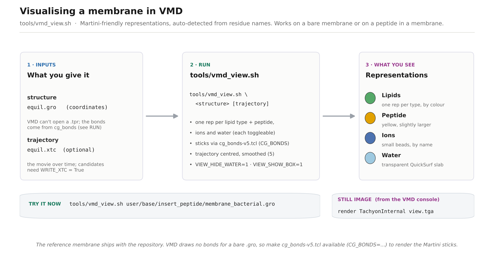

# amp-evo-md

Physics-based design of antimicrobial peptides by embedding coarse-grained molecular dynamics
in a genetic algorithm.

Adapted from the Evo-MD code of van Hilten, Methorst, Verwei and Risselada
(Sci. Adv. 2023, 9(11), eade8839, DOI 10.1126/sciadv.ade8839), which optimised curvature
sensing peptides. The genetic algorithm, the GROMACS wrappers and the simulation scaffolding
are theirs. What changed is the axis of comparison and the objective.


This fork optimises one thing: disruption of a bacterial target membrane. A genetic algorithm
proposes peptide sequences, each is simulated on the target membrane with coarse-grained
molecular dynamics, and the induced leaflet tension (`delta_gamma`) scores how much the peptide
destabilises it. The study was originally dual-objective (damage the bacterial membrane and spare
a mammalian host); it was narrowed to the target alone after a class-validation run, for the
reasons in [Scope](#scope-why-this-is-target-only-damage) below.

## Contents

- [Scope: why this is target-only damage](#scope-why-this-is-target-only-damage)
- [What problem this addresses](#what-problem-this-addresses)
- [The membrane system](#the-membrane-system)
- [The peptide model: imposed helix and search space](#the-peptide-model-imposed-helix-and-search-space)
- [Order of work](#order-of-work)
- [Installation on an Ubuntu workstation](#installation-on-an-ubuntu-workstation)
- [The dry run](#the-dry-run)
- [Running it](#running-it)
- [Logs and diagnostics](#logs-and-diagnostics)
- [Analysis and figures](#analysis-and-figures)
- [Troubleshooting](#troubleshooting)
- [Limitations to state rather than discover](#limitations-to-state-rather-than-discover)
- [Changes to the upstream code](#changes-to-the-upstream-code)
- [Requirements](#requirements)
- [Layout](#layout)
- [References](#references)
- [Appendix: the first class-validation](#appendix-the-first-class-validation)

## Scope: why this is target-only damage

This study optimises a single objective: how strongly a peptide disrupts the bacterial target
membrane. It does not model selectivity against a host membrane. That is a deliberate narrowing
from the original dual-objective design, and the reasons are worth stating plainly because they
shape every result.

The original plan had two membranes: a bacterial target to damage and a mammalian host to spare,
with selectivity as the second objective. A first class-validation run (nine peptides of known
activity, one replica each) showed the two-membrane model could not be trusted on two counts: the
scored damage observable was too noisy at a single replica to rank peptides, and the pure-POPC host
could not reproduce selectivity at all, because the determinant it is missing is cholesterol and a
trustworthy cholesterol host was not feasible with the available membrane builder. The full
diagnosis, with the numbers, is in
[Appendix: the first class-validation](#appendix-the-first-class-validation) at the end.

Given that, the study was scoped to the target membrane alone: one fully controlled membrane
instead of a two-membrane model whose second half was known to be wrong. The consequences of the
single-objective scope, stated so they are not discovered later:

- A single damage objective optimises **potency, not therapeutic selectivity**. Maximising
  bacterial-membrane disruption tends toward highly hydrophobic, cationic, strongly lytic peptides,
  which in reality are often haemolytic. Nothing in this pipeline penalises host toxicity.
- **Toxicity and selectivity are out of scope here and are future work.** They must be handled
  downstream, for example by a haemolysis or toxicity predictor, or experimentally, and ultimately
  by a validated cholesterol-containing host (POPC:CHOL or POPC:DPSM:CHOL) recalibrated from
  scratch and a selectivity term restored to the objective.
- The host machinery is **archived, not deleted**. The host entry is kept commented in
  `user/membranes.py` and the binding objective remains in the code, so selectivity can be restored
  once a trustworthy host exists.

The validation was then redesigned around this scope: a balanced two-class separation (six active
peptides against the bacterial target versus six composition-matched inactive controls), three
independent replicas per peptide, described in [Order of work](#order-of-work) and the running
steps below.

## What problem this addresses

The original compares one membrane composition held at two areas, and measures how much the
peptide reduces the work needed to stretch the leaflet. That difference is curvature sensing.

Here the quantity is the same (surface tension at constant area) but it is read on one bacterial
target membrane and turned into a single objective: induced leaflet strain, used as a damage
proxy. A positive strain means the peptide destabilises the leaflet it occupies. There is no
second membrane and no selectivity term (see [Scope](#scope-why-this-is-target-only-damage)).

| | original | this fork |
|---|---|---|
| compared | two tension states of one membrane | one bacterial target composition |
| ensemble | constant area | constant area, unchanged |
| measured | surface tension, insertion depth | surface tension, insertion depth, peptide-lipid interaction energy |
| objective | curvature sensing free energy | induced leaflet strain (damage) on the target |

### The objective: membrane damage

The objective is **damage**: maximise `delta_gamma` on the bacterial target membrane.
`delta_gamma = gamma(free) - gamma(with peptide)` at constant area, so a positive value means
the peptide relieves tension in the leaflet it occupies, which is the same statement as the
peptide generating leaflet strain. This is a damage observable rather than a binding one: the
mechanical reading in the source paper is that a peptide which senses leaflet tension also
induces it, and that membrane-binding peptides therefore lower the energetic cost of the
curved interface of a toroidal pore. Curvature selectivity needed the derivative of this
quantity with respect to area; damage does not, so one area state suffices.

With the host archived (see [Scope](#scope-why-this-is-target-only-damage)), the damage objective
has no host term: `user/modules/fitness_damage.py` applies its hinge host penalty only when a
host membrane is registered, and none is, so the fitness is `delta_gamma` on the target alone.

A second objective, **binding** (a partitioning proxy, target relative to host), remains in the
code (`user/modules/fitness_binding.py`, `OBJECTIVE = "binding"`) but is not used in this study:
it needs the host that was archived. It is left in place so selectivity can be restored later.
The three standing limitations of the damage observable, documented in `fitness_damage.py`, are
the dilute peptide-to-lipid limit (one peptide per roughly 200 lipids, whereas AMPs act
cooperatively), that generating tension is necessary for rupture but not sufficient (nothing knows
where the rupture threshold is), and that the constant-area ensemble is load-bearing (under a
constant-tension barostat the area would respond and the observable would vanish, so `Pcoupltype`
must not change without replacing the observable).

The objective is gated on the **orientation factor** (Eq. 3 of the source paper), a number in
[0, 1] measuring whether the peptide was at the interface at all. Two properties of it are worth
knowing, because both were wrong and both were invisible:

It is averaged over frames, not evaluated at the mean insertion depth. The cosine window is
symmetric about the reference depth `b`, so a peptide that spends half the window buried between
the leaflets and half dissolved in water has a mean depth of almost exactly `b`. Evaluated at
that mean it scores 1.0, the maximum possible weight, for a trajectory that was never at the
interface.

Below `ORIENTATION_reject_below` the candidate is rejected rather than scaled, at
`DETACHED_FITNESS`. Scaling cannot express what a low factor means. The factor multiplies only a
positive score, so a detached peptide scored exactly 0.0 and, on a maximised fitness, 0.0 beats
every attached peptide whose `delta_gamma` is negative. In early generations most random
sequences are in that position, so detaching was worth more than most honest attempts and the
fitness trace would have shown only a plateau at zero. A rejected candidate is not a penalised
measurement; it is a statement that the measurement does not mean what the objective assumes.

### What carries over from the source paper, and what does not

The transferable asset is not the fitness function, which is specific to curvature. It is:

1. Physics-based fitness inside a genetic algorithm is affordable only if the observable is a
   cheap readout. In the original it is a single `gmx energy` call on the surface tension, not
   an alchemical calculation. That ceiling constrains every choice of observable here.
2. Maximising a single physical observable returns its degenerate extreme, not a usable
   peptide. The source paper set out to optimise curvature sensing and obtained the optimal
   binder: a sequence so hydrophobic it would aggregate out of solution. Maximising damage, the
   objective here, reproduces that hydrophobic extreme directly, which is the same force that
   makes a potent membrane disruptor haemolytic. This is why the search carries a hydrophobic
   fraction cap, and why target-only damage optimises potency rather than selectivity (see
   [Scope](#scope-why-this-is-target-only-damage)): without a host term, nothing opposes the
   hydrophobic extreme except that cap. (The archived binding objective fails differently, toward
   a maximally cationic, weakly potent, salt-sensitive peptide, because hydrophobic insertion
   cancels in a target-minus-host difference and leaves electrostatics; a different failure, still
   a failure, and a reason selectivity needs a trustworthy host before it is optimised.)
3. The useful regime is therefore a window on the objective, and the window has to be
   calibrated against peptides whose behaviour is known experimentally. Without that
   calibration the output is a ranking without a scale.

### Relation to Evo-MD-FE

Biriukov and Vacha (2026, reference 2 below) independently adapted the same Evo-MD lineage to a
bacterial membrane, optimising peptides that reduce the line tension of a membrane pore. Their
work overlaps this one and bounds what is left to do here, so the differences are worth stating
precisely rather than discovering later.

They model an effectively infinite toroidal pore as a lipid stripe, take the box size along the
rim as a collective variable, and obtain the line tension from the slope of the free-energy
profile over three umbrella-sampling windows. Their fitness is the relative reduction of that
line tension. The cost is comparable to the production runs used here, which disposes of the
assumption that pore energetics are too expensive for a genetic algorithm: what was missing was
the collective variable, not the compute.

What does not transfer, and why:

- Their headline result is that the best line-tension reducers carry a negatively charged polar
  face, with lysine almost absent among top performers. That result was obtained with a hybrid
  Martini 2.2 model using polarisable water, chosen specifically because line tension requires
  it. Charge-related conclusions are the ones most sensitive to the water model, and this fork
  keeps Martini 3 with non-polarisable water, so the result is not imported as a prior.
- Their aromatic-terminal motif is strongly positional: cyclic shifts of their best sequence that
  preserve composition and helical-wheel arrangement all performed worse. The mechanism they
  propose is specific to the pore rim, where aromatic ends anchor both helix ends and align the
  peptide parallel to the membrane edge. The geometry here is a flat bilayer with no rim, so the
  selective pressure that produced the motif is absent and the motif is not encoded as a
  constraint. Whether it emerges anyway from an unconstrained run is a result either way.
- They report that two model curvature-sensing peptides showed no appreciable line-tension
  reduction. This is a direct challenge to the premise of the damage objective here, which treats
  induced leaflet strain as a damage proxy. Pore formation and pore stabilisation may simply be
  different steps, weakly correlated or anticorrelated. The calibration run settles it cheaply.

A step their conclusions leave open is membrane recruitment and selectivity: they simulate
peptides already placed at the pore rim, and flag explicitly that whether their anionic peptides
can target an anionic membrane remains to be established. Recruitment against a host membrane is
what the archived binding objective was meant to measure. With the host descoped to future work,
this fork does not address that step either; the tension between the two requirements (cationic
for recruitment, anionic for pore-rim stabilisation) is noted here as the interesting question a
selectivity-capable successor would face.

Adopted from their methodology, all of it force-field independent: neutral peptide termini
(`martinize2 -nt`, since charged termini add an orientation-dependent contribution to the
measured surface tension that has nothing to do with the sequence), explicit physiological salt
in the membrane build, and the exclusion of isoleucine on the grounds documented in
`user/usersettings.py`. Replicate evaluations per candidate are used in the class-validation run
(three independent replicas per peptide, averaged, with the between-replica spread as the
uncertainty); in a GA campaign the genetic algorithm's rerun averaging covers the elites.

## The membrane system

There is one membrane: a Gram-negative inner-membrane mimic, **POPE:POPG in a 3:1 ratio** (70:30),
built with the Martini 3 coarse-grained force field and non-polarisable water. POPG makes the
bilayer anionic, which is the property antimicrobial peptides discriminate on. Cardiolipin (CDL2)
belongs in a faithful inner-membrane mimic and is what makes it most strongly anionic, but its
Martini 3 parameters are not shipped here, so the campaigns run on POPE:POPG and add cardiolipin
once its parameters are in place.

A mammalian host membrane (a pure-POPC bilayer in the original design) is **archived, not used**:
it could not reproduce selectivity (see [Scope](#scope-why-this-is-target-only-damage)), its entry
is kept commented in `user/membranes.py`, and a realistic host needs cholesterol and sphingomyelin
whose Martini 3 parameters and a trustworthy build are future work.

Size, as built:

| property | value |
|---|---|
| composition | POPE:POPG 3:1 (70% POPE, 30% POPG) |
| lateral box | 8.0 x 8.0 nm, held at constant area |
| box height | about 9.7 nm (membrane plus two water slabs) |
| lipids | about 208 (104 per leaflet) |
| water | about 2900 Martini W beads, roughly 14 per lipid |
| salt | 0.15 mol/L NaCl, on top of neutralising counterions |
| beads, total | about 5300 |
| force field | Martini 3, non-polarisable water |



The lipids in all-atom and Martini 3 coarse-grained form, and the target membrane's composition
and charge balance (POPC appears as the archived host lipid). They share tails, glycerol and
phosphate; only the head bead differs, and that is what sets the charge. POPG is anionic because
its glycerol head (GL0) carries no cation to cancel the phosphate, so each POPG is -1; POPE (NH3,
+1) and POPC (NC3, +1) are zwitterionic and net neutral. The anionic POPE:POPG surface is what a
cationic antimicrobial peptide is recruited to and disrupts. Regenerate the figure with
`python docs/make_membranes_figure.py` (needs `matplotlib`).

The equilibrated structure is produced once at zero tension and reused for every candidate (see
[The equilibrated membrane is a committed standard](#the-equilibrated-membrane-is-a-committed-standard)),
so the per-candidate cost is only the peptide insertion and the production run.

### What is measured

Each production run writes one `observables.json`. Five quantities are read from it, and the two
objectives are pure functions of these, which is why re-scoring under the other objective needs
no new simulation.

| variable | symbol | what it is | source |
|---|---|---|---|
| surface tension | gamma | leaflet tension at the fixed area | `gmx energy`, the `#Surf*SurfTen` term |
| induced strain | delta_gamma | gamma(free membrane) minus gamma(membrane with peptide) | difference against the reference membrane |
| interaction energy | e_lipids, e_sol | peptide-lipid and peptide-solvent Coulomb and Lennard-Jones energy | `gmx energy` on index energy groups |
| insertion depth | d_mem | how deep the peptide sits relative to the bilayer midplane | trajectory analysis |
| orientation factor | | a cosine window in [0, 1]: whether the peptide was at the interface at all | averaged over frames, not taken at the mean depth |

`delta_gamma` drives the damage objective. The interaction energy and insertion depth are not
scored here (they were the archived binding proxies), but they are kept in every `observables.json`
as diagnostics: in the class-validation run they separated active from inactive peptides more
cleanly than `delta_gamma` did, so they are the first candidates if the damage observable needs
replacing. The orientation factor gates the objective, rejecting a candidate that left the
interface rather than scaling its score.

### One target membrane, replicate runs

Each candidate is simulated on the one registered membrane, the bacterial target. The peptide is
built once, inserted into the target, and run through production, so every observable above exists
once per run: `delta_gamma`, the interaction energy, the insertion depth and the orientation
factor. The fitness is the target's `delta_gamma` (gated by the orientation factor); there is no
host term because no host is registered. A candidate therefore costs one production run per
replica, rather than the two-per-candidate of the original dual-membrane design.

Because `delta_gamma` from a single 200 ns trajectory was too noisy to rank peptides (the
class-validation run showed its error comparable to the between-class signal, and two near-identical
magainin variants gave very different values), the validation runs **three independent replicas**
per peptide (`N_REPLICAS = 3`, directories `<SEQ>_rep1`, `_rep2`, `_rep3`). The per-peptide value is
the mean over replicas and the uncertainty is the between-replica spread, which is the honest error
bar a single trajectory cannot give. The replicas are made genuinely independent, not just reseeded
copies of one pose: each replica rolls the peptide about its own helix axis by a distinct angle
before insertion (0, 120 and 240 degrees for three replicas, set in the insertion module via
`gmx editconf -rotate`), so each starts with a different face toward the bilayer, and on top of that
the velocity seed is random (`gen_seed = -1` in the mdp). This directly addresses the single-replica
failure mode, where one trajectory could settle into an unrepresentative orientation and define the
peptide on its own. `calibrate.py` aggregates by sequence, averaging the replicas before the
go/no-go. Keeping every replica's trajectories on disk is covered under
[Data retention](#data-retention).

### How it compares to the source papers

| | van Hilten 2023 (source) | Biriukov and Vacha 2026 (Evo-MD-FE) | this fork (AMP-evo-MD) |
|---|---|---|---|
| membrane | POPC, single component | POPE:POPG 3:1 | POPE:POPG 3:1 target (host archived) |
| force field | Martini 3 | Martini 2.2, polarisable water | Martini 3, non-polarisable water |
| geometry | flat bilayer, two tension states | lipid stripe with a pore rim | flat bilayer, constant area |
| observable | curvature-sensing free energy | pore line tension, umbrella sampling | induced leaflet strain on the target |
| the GA optimises | curvature sensing | line-tension reduction | membrane damage (target only) |

The composition matches Biriukov and Vacha; the force field and water model match van Hilten. The
reasons for keeping Martini 3 non-polarisable water, rather than importing their polarisable
charge-related conclusions as a prior, are in [Relation to Evo-MD-FE](#relation-to-evo-md-fe)
above.

## The peptide model: imposed helix and search space

### Secondary structure is imposed, not predicted

Every candidate is modelled as an ideal alpha-helix. For each sequence the pipeline writes an
all-`H` secondary-structure string (`"H" * len(sequence)`), builds the atomistic helix with
PeptideBuilder, and coarse-grains it with `martinize2 -ss`. In Martini 3 the secondary structure is
supplied as an input: it sets the backbone bonded terms (bonds, angles, dihedrals) that hold the
helix. Unlike Martini 2, the backbone bead type in Martini 3 no longer depends on the secondary
structure; only the bonded terms do. The force field cannot fold, so the helix is an assumption, not
a result. No elastic network or Go/OLIVES bias is applied: for a single helix the SS-dependent
bonded terms maintain helicity on their own, and there is no tertiary structure to hold.

This is the central structural assumption of the whole approach, and it is a stronger one for AMPs
than it was for the curvature sensors this method came from: many AMPs are disordered in solution
and fold only on contact with the membrane, so imposing a rigid helix assumes the bound, folded
state throughout. It is the first limitation to state and the first thing to revisit if the
calibration set misranks (the STATE=1 gate exists for exactly this).

### How the works we build on handle it

Imposing secondary structure is standard in Martini, because the model is built that way, not as a
shortcut:

- **Evo-MD, the base method (van Hilten et al. 2023).** Assumes and fixes an alpha-helix when
  generating starting conformations, justified because membrane-surface peptides are mostly
  alpha-helical and the Martini force field cannot model protein folding. Same build path
  (PeptideBuilder then martinize2/VerMoUTH). We follow it directly.
- **Martini protein models (Monticelli et al. 2008; Martini 3, Souza et al. 2021).** Secondary
  structure is a required input encoded through bonded terms, never predicted. Holding a tertiary
  structure needs an added bias (elastic network, GoMartini, or OLIVES); a single helix does not,
  which is why we add none.
- **AMPs in Martini.** Studies that simulate specific AMPs with membranes also impose the helix.
  Gkeka and Sarkisov (2010), simulating amphipathic helical peptides including magainin-H2, state the
  model "assumes a known secondary structure that does not change" and even remove Martini's imposed
  SS constraint on two terminal residues, confirming the helix is model-imposed rather than emergent;
  Santo and Berkowitz (2012) likewise simulate magainin-2 and melittin as Martini helices.

The difference in kind: those AMP studies simulate one peptide whose experimental helix is known, so
imposing it is well grounded. We design de novo across a sequence search, with no experimental
structure per candidate, so, like Evo-MD, we impose a generic helix and treat "would this sequence
actually be helical" as outside the model.

### The search space is restricted

Like the base method, the GA does not sample all 20 residues. The active alphabet is 11 residues; the
rest carry weight 0 in the sampling table and never appear. Length is fixed, and there are explicit
charge and solubility windows, all enforced as search-space constraints before any simulation runs.

| Setting | Value | Reason |
|---|---|---|
| Alphabet (11) | A, E, F, K, L, M, Q, R, S, W, Y | helix-prone set, cationic-capable |
| Excluded: G, P | glycine, proline | helix breakers, incompatible with the imposed helix (martinize2 also cannot assign a terminal proline) |
| Excluded: D, C, T, N, H, V | low alpha-helical propensity | inherited from the base method's helix-prone alphabet |
| Excluded: I | isoleucine | in Martini 3, Ile and Leu share identical bead types (backbone P2, side chain SC2), so they are indistinguishable in every interaction the pipeline measures; searching both is redundant. Val is distinct (SP2/SC3) and is excluded only on helix propensity |
| Length | fixed 24 residues | n/a |
| Net charge | (K+R) - (D+E) in [+3, +9] | cationic AMP character; our addition, the base method imposed no charge constraint |
| Hydrophobic fraction | at most 0.65 | solubility guard against the aggregation failure the curvature paper documented (its optima were so hydrophobic they would precipitate) |

One deliberate departure from the base method: **arginine is re-enabled.** Excluding Arg is
defensible for curvature sensors but not for AMPs, where it carries much of the cationic character
and interacts with anionic headgroups differently from lysine. The net-charge window and the
hydrophobicity cap are also ours, not the base method's, and encode AMP-specific biology and
solubility.

### What this excludes relative to natural AMPs

The restriction is honest about what it gives up. Several excluded residues are not rare in natural
AMPs; they are among the most characteristic, and the exclusions follow from the imposed helix and a
force-field degeneracy, not from any evidence that these residues are bad for antimicrobial activity:

- **Cysteine and glycine** are enriched in antimicrobial peptides relative to typical proteins (APD3,
  DBAASP, DRAMP). Excluding Cys removes the entire disulfide-stabilised class (defensins, protegrins,
  theta-defensins), which is beta-sheet or cyclic rather than helical. Excluding Gly removes
  glycine-rich AMPs and the glycine hinges common in membrane-active peptides.
- **Proline** defines the proline-rich AMPs (apidaecin, drosocin, Bac7), which act on intracellular
  targets, and the proline hinges found in many linear helical AMPs.
- **Histidine** drives pH-sensitive AMPs (histatins, clavanins).

The design is therefore confined to the cationic, amphipathic, alpha-helical sub-universe (magainin,
LL-37, cecropin-like), which is the intended target, but it cannot reach whole, abundant classes of
natural AMPs. This is a property of the method, stated so that results are read as "the best cationic
amphipathic helix the model can find", not "the best antimicrobial peptide".

### Sources

- [van Hilten et al. 2023, Science Advances (Evo-MD)](https://pmc.ncbi.nlm.nih.gov/articles/PMC10022891/)
- [Monticelli et al. 2008, JCTC, Martini protein model](https://cgmartini.nl/docs/publications/entries/2008/Monticelli2008_Proteins.html)
- [Souza et al. 2021, Nature Methods, Martini 3](https://doi.org/10.1038/s41592-021-01098-3)
- [Martini 3 structure-bias comparison, bioRxiv 2025](https://www.biorxiv.org/content/10.1101/2025.03.17.643608)
- [Pedersen et al. 2024, JCTC, OLIVES](https://doi.org/10.1021/acs.jctc.4c00553)
- [Gkeka and Sarkisov 2010, J. Phys. Chem. B](https://doi.org/10.1021/jp908320b)
- [Santo and Berkowitz 2012, J. Phys. Chem. B](https://doi.org/10.1021/jp212018f)

## Order of work

The calibration run comes first, and it uses no genetic algorithm.

0. **Run the dry run once.** `python tools/dryrun.py` exercises every step below on a system
   small enough to finish in about twelve minutes, so that the first thing a long run tests is
   the science rather than the installation. See [The dry run](#the-dry-run).
1. **Reproduce the source paper's POPC membrane.** The only step whose right answer is known in
   advance: their free-membrane surface tension is published and their system is shipped here as
   provenance. Agreement says the build, equilibration, production and extraction chain is sound
   before any of it is used on a composition nobody has measured.
   See [Step 1a](#step-1a-reproduce-the-source-papers-membrane-first).
2. **Build and calibrate the target membrane.** The composition needs its own reference
   measurements, taken on the peptide-free membrane: box area, free-membrane surface tension,
   and bilayer thickness. These are not transferable between compositions. The procedure is
   documented at the top of `user/membranes.py`. Until the numbers are filled in and the
   equilibrated `.gro` and `.top` are copied into place, anything that would run a simulation
   refuses to start. Those are two separate steps and the second is the one usually missed.
   `calibrate.py` does not check either, because re-scoring an existing result set does not
   touch the membrane. The bacterial target ships already calibrated in this repository; only a
   new composition needs this step.
3. **Measure the calibration set, with replicas.** Fill `seq.txt` with peptides of known
   activity against the target, then run `STATE = 1` in `run.py` with three replicas per peptide.
   For target-only damage the classes are two: active (damages the bacterial membrane) and
   inactive. The actives fix one end of the scale and the inactive controls fix the other;
   replicas are what make the per-peptide value trustworthy, since a single trajectory was too
   noisy to rank (see [One target membrane, replicate runs](#one-target-membrane-replicate-runs)).
4. **Check whether the observable separates active from inactive.** `calibrate.py` scores those
   results under the damage objective and reports pairwise concordance against the labels. This is
   the go/no-go: an optimiser cannot recover a signal that is not in the observable, so a no-go
   means revisiting the observable or the sampling before any campaign, not running one.
5. **Only then run a campaign.** `run.py` with `STATE = 0`.

## Installation on an Ubuntu workstation

Two situations, with different first steps. Pick the one that matches the machine.

- **A: you have `sudo`.** Install the system packages, then continue from step 2.
- **B: you do not have `sudo`, and GROMACS comes from a module.** The common lab and cluster
  case. Skip to "Installing without root" below, then continue from step 2.

Everything after step 1 is identical in both cases and needs no root.

### 1A. System packages, with sudo

```bash
sudo apt update
sudo apt install -y build-essential git python3 python3-pip python3-venv \
                    gromacs libopenmpi-dev openmpi-bin
```

Ubuntu's `gromacs` package installs the binary as `gmx` and is fine for this pipeline. If the
lab has its own GROMACS build, use that instead and skip the `gromacs` package: a source build
is typically 2 to 3 times faster because it is compiled for the machine's own instruction set,
which matters a great deal across thousands of evaluations. A source build with MPI usually
installs the binary as `gmx_mpi` rather than `gmx`; see the `GMX` variable below.

### 1B. Installing without root

Nothing in this pipeline needs to be installed system-wide. The three things `apt` would have
provided are a GROMACS binary, an MPI library, and a Python with `venv`, and on a machine with
environment modules the first two normally come from modules while the third is usually already
present.

**Find and load the modules.** The exact names vary by site, so list them rather than guessing:

```bash
module avail 2>&1 | grep -i -E "gromacs|gmx"
module avail 2>&1 | grep -i -E "openmpi|mpich|mpi|python"
```

Load GROMACS **with an explicit version**, and note whether it brings MPI with it:

```bash
module load gromacs/2025.3     # the exact name and version 'module avail' printed
which gmx gmx_mpi
gmx --version | head -20       # or gmx_mpi --version
```

Name the version. A bare `module load gromacs` resolves to whatever the site has set as the
default, and administrators change that default without announcing it. Intending to use one
version is not the same as having used one, which is what the pinning below makes checkable.

The lines to read are `GROMACS version` (anything from 2021 onward works) and `GPU support`,
since CUDA support cuts the per-candidate cost substantially. If the binary is `gmx_mpi`, set
`export GMX=gmx_mpi` later; the pipeline reads that variable rather than assuming a name.

**Put the module loads in a file, and source that file, rather than putting them in
`.bashrc`.** A ready-made one ships with the repository:

```bash
cp ~/AMP-evo-MD/tools/amp-env.sh.example ~/amp-env.sh
nano ~/amp-env.sh          # edit the three marked lines at the top
```

The three lines are the clone path, the exact GROMACS module name, and the binary name (`gmx` or
`gmx_mpi`). Everything else is handled: it checks the module actually loaded, confirms the binary
is on `PATH`, reads the version from the binary itself rather than trusting the module name,
activates the virtual environment, and sizes the MPI ranks and threads for the machine.

Load it before working, in every new shell:

```bash
source ~/amp-env.sh
```

It prints what it set, so you can see at a glance which environment a terminal is in:

```
amp-env loaded
  root              /home/madson/AMP-evo-MD
  gmx               /opt/gromacs/2025.3/bin/gmx
  gmx version       2025.3  (pinned as 2025.3)
  python            /home/madson/AMP-evo-MD/.venv/bin/python3
  MPI ranks         15
  threads per rank  2
```

**Do not put the contents in `~/.bashrc`.** It runs in every shell you open on that machine:
`module purge` would drop the modules of any other work you have loaded, activating the
virtualenv would make every `python` on the machine this project's python, and the core detection
would spawn a subprocess on every shell start, which on a networked filesystem is slow enough to
notice over ssh. The failure mode is worse than the cost: if the site's module default changes,
`tmux` sessions opened before the change keep the old environment while new ones get the new one,
and you end up with half a campaign from each build. Loading the environment should be deliberate
and visible in the shell you did it in.

For convenience, put only an alias in `~/.bashrc`:

```bash
echo "alias ampenv='source ~/amp-env.sh'" >> ~/.bashrc
```

Then `ampenv` loads it and the rest of the machine stays untouched.

`GMX_VERSION_EXPECT` pins the build. `run.py` checks the running GROMACS against it at the start
of both the campaign and the calibration run, and stops with a clear message on a mismatch, rather than producing numbers that silently do not
belong with the rest of the campaign. Matching is a prefix test, so `2024` accepts any 2024.x
and `2025.3` does not accept `2025.4`. Leave it unset and the version is recorded but not
enforced.

**If `python3 -m venv` is unavailable.** Some minimal installs ship Python without `venv`. Check
first, since this is usually a non-problem:

```bash
python3 -m venv --help >/dev/null 2>&1 && echo "venv ok" || echo "venv missing"
```

If it is missing, install a complete Python into your home directory with micromamba. It is a
single static binary, needs no root, and does not touch anything outside `~/micromamba`:

```bash
cd ~
curl -Ls https://micro.mamba.pm/api/micromamba/linux-64/latest | tar -xvj bin/micromamba
./bin/micromamba shell init -s bash -p ~/micromamba
source ~/.bashrc
micromamba create -y -n amp python=3.11
micromamba activate amp
```

With micromamba active, use `micromamba activate amp` wherever the steps below say
`source .venv/bin/activate`, and skip the `python3 -m venv` line.

**MPI without root.** `pip install mpi4py` now ships a binary wheel, and that wheel does not
bundle an MPI library: it links dynamically against `libmpi.so.40` (OpenMPI) or `libmpi.so.12`
(MPICH) and picks whichever it finds at import time. So as long as a module provides one of
those, the wheel works with no compiler and no root. Verify after installing:

```bash
python -c "from mpi4py import MPI; print('MPI ok, size =', MPI.COMM_WORLD.Get_size())"
```

If that fails with `libmpi.so.* not found`, load an MPI module (`module load openmpi`) and try
again. If it still fails, the site's MPI has an incompatible soname, and the fallback is to
compile mpi4py against it:

```bash
export MPICC=$(which mpicc)
pip install --no-binary=mpi4py --force-reinstall mpi4py
```

That needs a compiler, which a `gcc` module usually provides. And if none of this works, the
pipeline still runs: `mpi4py` is optional throughout, and both the campaign and the calibration
set fall back to a single process. It is slower, not blocked.

### 2. Python environment

A virtual environment, never the system Python. Nothing here is pinned, but `vermouth` and
`PeptideBuilder` pull in versions that are better kept isolated, and on a shared machine you
would not be able to install them system-wide anyway.

```bash
git clone https://github.com/madsondeluna/AMP-evo-MD.git
cd AMP-evo-MD

python3 -m venv .venv            # or: micromamba activate amp
source .venv/bin/activate

pip install --upgrade pip
pip install numpy matplotlib vermouth PeptideBuilder
pip install mpi4py               # optional, see 1B; everything runs serially without it
```

`vermouth` provides the `martinize2` command that converts an atomistic peptide into its
coarse-grained topology. Confirm everything is reachable:

```bash
python -c "import numpy, matplotlib, PeptideBuilder; print('python deps ok')"
python -c "from mpi4py import MPI; print('MPI ok')" || echo "no MPI: serial only, fine"
martinize2 --version
```

If `pip` cannot reach the network on a locked-down machine, download the wheels on a machine
that can and copy them over:

```bash
# on a machine with network access, matching the target's Python version:
pip download numpy matplotlib vermouth PeptideBuilder mpi4py -d wheels/
# then on the lab machine:
pip install --no-index --find-links wheels/ numpy matplotlib vermouth PeptideBuilder
```

### 3. insane, for building membranes

`insane.py` builds the initial lipid bilayer. It is not on PyPI, and it goes in your home
directory, so this step needs no root either:

```bash
mkdir -p ~/bin
curl -L https://raw.githubusercontent.com/Tsjerk/Insane/master/insane.py -o ~/bin/insane
chmod +x ~/bin/insane
export PATH="$HOME/bin:$PATH"
insane --help | head -5
```

Add that `PATH` line to `~/amp-env.sh` alongside the module loads, so a run always picks up the
same set of tools.

### 4. Verify the installation

The test suite runs without GROMACS, because the scoring layer is a pure function of the
observables file. Most of it takes about a second; the dry-run tests add a dozen seconds
because each runs the driver as its own process:

```bash
python -m unittest discover -s tests
```

Then exercise the reporting tools against synthetic data, which checks matplotlib and the
parsers without spending any simulation time:

```bash
python tests/make_fake_progress.py --out /tmp/fake_progress.txt
python tools/ga_report.py /tmp/fake_progress.txt --outdir /tmp/ga_report
```

That writes `performance.png`, `composition.png`, `positional.png`, `progress.csv` and
`summary.json` to `/tmp/ga_report`. If those appear, everything except GROMACS itself is
working.

Last, run the same preflight a campaign runs, which checks the external programs rather than the
Python layer. It takes about a second and needs no membranes, so it is usable before step 1:

```bash
python -c "import run; run.preflight(membranes=False)" && echo "environment ok"
```

Silence and `environment ok` mean `gmx`, `martinize2` and `PeptideBuilder` all run. Anything
missing is named, with the fix. Drop `membranes=False` once the membranes are prepared to check
their files and reference values as well.

Those three checks cover the installation. To check that the pipeline itself works end to end,
see [The dry run](#the-dry-run), which runs every step on a small system in about twelve
minutes. It is worth doing once before the first real campaign.

### 5. Environment variables

| Variable | Purpose | Default |
|---|---|---|
| `GMX` | GROMACS binary name | `gmx` |
| `GMX_VERSION_EXPECT` | pin the GROMACS version; runs stop on a mismatch | unset, version recorded but not enforced |
| `MARTINIZE2` | martinize2 binary | `martinize2` |
| `OMP_NUM_THREADS` | threads per GROMACS process | set it explicitly, see below |

A complete `~/amp-env.sh` for a machine with modules and no root:

`tools/amp-env.sh.example` sets all of these. Copy it to `~/amp-env.sh`, edit the three marked
lines, and `source ~/amp-env.sh` at the start of every session. It also exports `AMP_NP`, the
rank count the commands below use.

### Provenance: what actually ran

Every campaign records the GROMACS version and banner, the martinize2 and Python package
versions, and the loaded module list in the header of its progress file. Every candidate records
the GROMACS version in its own `observables.json`, so a single result is self-describing and a
later re-score does not depend on trusting a note about which build was loaded.

`calibrate.py` warns when a set of results was produced by more than one build and reports how
many candidates came from each. This matters because surface tension is sensitive to the build:
a version change shifts the values in a way that looks exactly like a real effect of the
sequences, and nothing else in the output would reveal it.

Check what a finished run used:

```bash
head -40 campaign_damage/output.txt                     # the campaign header
python -c "import json; print(json.load(open('campaign_damage/KWLRK.../observables.json'))['_provenance'])"
```

### Reproducing on another machine

Everything needed to reproduce the study is committed, so a second machine is a clone plus an
environment:

- The code, the membrane registry (`user/membranes.py`) and the committed equilibrated target
  membrane (`user/base/insert_peptide/membrane_bacterial.gro` and `.top`): same reference on any
  machine, no rebuild.
- The calibration set (`seq.txt`, `labels.csv`) and the scramble generator
  (`tools/make_scrambles.py`), which regenerates and verifies the designed controls from their
  parents, so the inactive class is reproducible rather than a list of opaque sequences.
- The run parameters, all in `user/usersettings.py` under version control (`SIM_time`, the
  timeouts, `N_REPLICAS`, `RETAIN_ALL_TRAJECTORIES`, `WRITE_XTC`), so a run is defined by the
  repository state, not by ad-hoc edits on one machine.
- `GMX_VERSION_EXPECT` pins the GROMACS build, and every `observables.json` records the build that
  produced it, so a cross-machine result set is checkable rather than assumed.

The one piece that is environment-specific is the Python environment. Capture it once on the
machine that produced the results and commit it, so the next machine installs the same versions:

```bash
source .venv/bin/activate
pip freeze > requirements.txt
git add requirements.txt && git commit -m "env: pin Python dependencies" && git push
```

On the second machine, after cloning and loading the same GROMACS module (see Installation),
recreate the environment with `pip install -r requirements.txt`, then run the dry run to confirm
the chain before any production.

## The dry run

Before committing a workstation to a campaign that runs for days, run the whole pipeline small.
`tools/dryrun.py` has every step the real thing has, on a system that finishes while you watch:

```bash
source ~/amp-env.sh
python tools/dryrun.py
```

It calls `tools/protocol.sh` for the membranes and `run.py`'s own modules for the candidates
rather than reimplementing either, because a smoke test that exercises different code than
production proves nothing about production. What it shrinks:

| | dry run | production |
|---|---|---|
| box | 6.0 x 6.0 nm | 8.0 x 8.0 nm |
| membranes | 2, one target one host | same |
| membrane runs | 1 ns equilibration, 1 ns production | 200 ns and 400 ns |
| candidate runs | 1 ns | 400 ns |
| peptide length | 12 residues | 24 |
| campaign | 4 candidates, 2 iterations | 144 candidates, 100 iterations |
| averaging window | last 50 percent | last 5 percent |

Roughly twelve minutes on eight cores. Nothing is written into the repository: the membranes it
builds go into the working directory, so a dry run cannot overwrite a prepared membrane, and the
settings are shrunk in memory rather than by editing `user/usersettings.py`.

**The numbers it produces are not usable.** The box is small, the runs are short, and the
averaging window is widened to compensate, so the surface tension is nowhere near converged.
A `MembraneDef` emitted by the dry run must never be pasted into `user/membranes.py`. The dry run
answers "does it run", not "is the answer right".

### What each stage checks

| Stage | Proves | Equivalent to running |
|---|---|---|
| 0 environment | `gmx`, `martinize2` and `PeptideBuilder` are reachable and report a version | the preflight every campaign runs |
| 1 membranes | a membrane can be planned, built with `insane`, minimised, equilibrated, measured, and turned into the four reference numbers | `tools/protocol.sh` |
| 2 one candidate | one sequence goes through all five modules and comes out with a score | `STATE = 1` with one sequence |
| 3 mini campaign | the GA evaluates, selects, mutates, writes a progress file and checkpoints | `STATE = 0` |
| 4 reports | the analysis tools read what the campaign wrote | `tools/ga_report.py` and `calibrate.py` |

Stage 4 matters more than its size suggests: it is normally the part that only gets exercised
days in, when there is finally something to analyse and a parsing mismatch costs a rerun.

### What you should see

Each stage prints what it is about to prove, the command it stands in for, what to expect, and
then what it actually got. The shape is fixed; the values below stand in for whatever your run
measures:

```
--------------------------------------------------------------------------------
STAGE 2  one candidate
--------------------------------------------------------------------------------
What this proves: a single sequence goes through every module of the per-candidate
pipeline and comes out with a score

Equivalent command:
  STATE = 1 in run.py, with one sequence in seq.txt

Expect:
  five steps in steps.jsonl: build_peptide, insert, production, observables, fitness
  an observables.json carrying surften, delta_gamma, e_lipids, d_mem and orientation
  a finite fitness, whose sign says whether the peptide raised or lowered the tension

  sequence                     LARKFLEKLYKQ
  steps                        build_peptide ok, insert ok, production ok, observables ok, fitness ok
  dry_target                   delta_gamma <value>, d_mem <value> nm, orientation <value>
  dry_host                     delta_gamma <value>, d_mem <value> nm, orientation <value>
  fitness                      <value>  (raw <value>)

PASS
```

What to read there is structural, not numerical: five steps all `ok`, an entry for each
membrane, and a finite fitness. The measured values are not comparable to anything at this run
length, which is why no reference numbers are given for them. The one number worth a glance is
`orientation`: a value at or near zero means the peptide left the membrane surface, which at
1 ns can happen by chance and in a real run would be a result.

The run ends with a table of stages and an explicit statement of what passing does and does not
mean.

Two things in the output look like problems and are not. Stage 1 will almost certainly warn that
the membrane is not tensionless: at 1 ns it cannot be, and that is precisely why these numbers
are not a calibration. Stage 3 may report a low acceptance rate when building the initial
population, because the charge window was tuned for 24-mers and the dry run uses 12-mers.

### When something fails

The summary names the stage, and the stage's own output names the cause. Later stages depend on
earlier ones, so the first failure is the one to read. The working directory is kept on failure
and removed on success; pass `--keep` to keep it either way.

```bash
python tools/dryrun.py --stage 1 --keep     # one stage, keeping everything it wrote
python tools/dryrun.py --from 2 --dir <dir> # resume in a directory from a previous run
```

### Without GROMACS

`--no-md` runs no simulation at all. It checks the driver, the settings overrides, the membrane
registry, the scoring layer, the genetic algorithm and the reporting tools, in a few seconds and
on any machine:

```bash
python tools/dryrun.py --no-md
```

Its value is diagnostic: it separates a broken environment from a broken pipeline. If `--no-md`
passes and the full dry run fails, the problem is GROMACS, `insane` or `martinize2` and not the
code. The summary says explicitly which claims it did not check, so it cannot be mistaken for the
real thing.

## Running it

### Step 0: load the environment, every session

Every command in the steps below assumes this has been run in the current shell:

```bash
source ~/amp-env.sh
cd ~/AMP-evo-MD
```

It is not optional and it does not persist. A new terminal, a new `tmux` window, or a reconnected
ssh session each need it again, because the modules, the virtualenv and the rank sizing live in
the shell and not on disk. The script prints what it set, so one look tells you whether a
terminal is ready.

Skipping it is the single most common way to get a confusing failure: `gmx: command not found`,
a `martinize2` from the wrong Python, or a campaign that runs on the site's default GROMACS
rather than the pinned one.

### Step 1a: reproduce the source paper's membrane first

Before building anything new, rebuild the membrane the source paper used and check that this
pipeline measures what they measured. It is the only point in the whole procedure where the right
answer is known in advance, and it costs one short run.

`calibration/reference_popc/` holds their system as provenance. Read directly from those files,
it is a pure POPC bilayer with no sterol, no salt and no second component:

| | source paper | what `membrane.py plan` computes |
|---|---|---|
| lipids | 64 POPC per leaflet, 128 total | 64 per leaflet, 128 total |
| box (equilibrium area) | 6.5104 x 6.5104 nm | 6.51 x 6.51 nm |
| area per lipid | 0.6623 nm2 | 0.662 nm2 |
| water | 1800 W | 1792 W |
| free-membrane surface tension | 1.93 +/- 0.99 bar nm | what you are checking |

```bash
BOX=6.5104 MAX_RESIDUES=24 ./tools/protocol.sh popc_reference "POPC:100" probe
```

The planner lands on their lipid count and their area per lipid from first principles, which is
already a check on the planning arithmetic; the 8-bead water difference is 0.4 percent and
irrelevant. What you are testing is the rest: that the build, the equilibration, the constant-area
production and the surface-tension extraction together reproduce a published number.

A result of zero within error agrees with them. A result far from zero means something in this
chain is wrong, and finding that out here costs one run, whereas finding it out from a finished
campaign costs the campaign. Note the `probe` role: this membrane is for validation and must not
become a scoring target.

This step uses only POPC, which both `insane` and the shipped Martini 3 files already handle, so
it runs before any decision about the lipids discussed below.

### Step 1: prepare and calibrate the membranes

Nothing else runs until this is done. `user/membranes.py` raises `UncalibratedMembrane` from
`run.py` and from the simulation modules while the reference values are missing, which is
deliberate: a plausible placeholder would propagate into every fitness value in the campaign
while looking entirely reasonable.

**The target membrane builds entirely from the Martini 3 lipids shipped in `user/base/`**, which
cover the phospholipids, the ions and the solvents. The bacterial target is POPE:POPG 3:1 and
needs nothing added. Cardiolipin (`CDL0`, `CDL1`, `CDL2`), which would make a Gram-negative inner
membrane more strongly anionic, is deferred because its Martini 3 parameters are distributed
separately. A mammalian host (cholesterol `CHOL` and sphingomyelin `DPSM` over POPC) is not built
here at all: it is archived (see [Scope](#scope-why-this-is-target-only-damage)). `tools/membrane.py
plan` checks that every lipid in a composition is parameterised and stops with the list before
`insane` builds a structure that `grompp` would refuse, so adding cardiolipin later, or a sterol
host when selectivity is taken up again, is a matter of dropping in the parameter files and
changing the composition string.

```bash
# First pass. Prints the plan and the insane command, then stops.
./tools/protocol.sh bacterial "POPE:70,POPG:30" target
```

Read the plan it prints. It reports the lipid counts, the water count, the box dimensions, and
whether a 30-residue helix fits with enough clearance from its own periodic image. Stopping here
on the first pass is intentional: lipid naming and the `insane` flags differ between Martini
lipid sets, and a wrong `-l` / `-u` split produces an asymmetric bilayer that looks fine until
the surface tension refuses to reach zero.

Once the plan looks right:

```bash
AUTO=1 ./tools/protocol.sh bacterial "POPE:70,POPG:30" target
```

This builds, minimises, and equilibrates at zero tension under a semi-isotropic barostat, then
measures the equilibrium area per lipid and prints a second plan with corrected lipid counts. The
zero-tension equilibration lets the box relax to the composition's own equilibrium area, so what
it leaves in `equil.gro` is already a tensionless membrane at that area. That is the reference
membrane the candidates insert into, so the production reference runs on it directly:

```bash
PASS=2 AUTO=1 ./tools/protocol.sh bacterial "POPE:70,POPG:30" target
```

There is no host membrane to build: it is archived (see
[Scope](#scope-why-this-is-target-only-damage)). When selectivity is taken up again, the host is
built the same way, with a sterol-containing composition and its own calibration.

Why not rebuild. The production ensemble is constant-area, so the box has to sit at the
composition's equilibrium area, otherwise the membrane is pre-stressed and its free surface
tension is not zero. The zero-tension equilibration already put the box there, so the equilibrated
membrane satisfies that condition with no rebuild. And `delta_gamma` is a difference measured at
one fixed box, `gamma(free) - gamma(with peptide)`, so any small residual baseline tension cancels
between the reference and the candidates, which use the same membrane. With one membrane, the
target, there is nothing to area-match, so the membrane is simply used at its own equilibrium
area. The only reason a rebuild to a common box would matter is comparing two membranes whose
natural areas differ a lot, which is a concern for a later composition such as a cholesterol host
(cholesterol condenses its neighbours); the 8.0 nm rebuild path (rebuild from `plan_pass2.txt`,
re-equilibrate, then `PASS=2`) is kept as an option for that case.

Useful overrides:

```bash
BOX=8.0 MAX_RESIDUES=30 SALT=0.15 EQUIL_NS=500 PROD_NS=400 \
    AUTO=1 ./tools/protocol.sh bacterial "POPE:70,POPG:30" target
```

Check the result before trusting it:

```bash
python tools/membrane_analysis.py single --name bacterial --dir prep/bacterial
python tools/membrane_analysis.py compare --dir prep --names bacterial host
```

Three things must hold, and all three fail quietly if ignored. The surface tension must be zero
within error: the Evo-MD POPC reference sits at 1.93 +/- 0.99 bar nm, and a value far from zero
means the box area and the equilibrium area disagree, so every peptide would be scored against a
pre-stressed bilayer. The area must have stopped drifting. The leaflets must be symmetric,
because an area mismatch between them shows up as spontaneous curvature and contaminates the
surface tension. The script states each verdict in words rather than leaving it to be read off
a number.

Finally, paste the emitted `MembraneDef` blocks into `MEMBRANES` in `user/membranes.py`, and
copy the equilibrated structures into place:

```bash
cp prep/bacterial/bacterial_eq.gro user/base/insert_peptide/membrane_bacterial.gro
cp prep/bacterial/bacterial.top    user/base/insert_peptide/membrane_bacterial.top

python -c "import user.membranes as m; m.require_all_calibrated(); print('membranes calibrated')"
```

### The equilibrated membrane is a committed standard

The equilibrated membrane is produced once, at zero tension for a pinned length, and the
structure is committed to the repository, so every machine starts from the identical membrane
instead of re-equilibrating. The recipe is versioned in `tools/build_reference_membranes.sh`,
which pins the composition, the box, the salt and the equilibration length, and builds the
POPE:POPG bacterial target (`bacterial`). **The standard equilibration is 500 ns** (the
`protocol.sh` default of 200 ns is a floor for exploratory builds).

```bash
source ~/amp-env.sh
cd ~/AMP-evo-MD

# In tmux or screen if either is installed (reattachable). Otherwise nohup, which still survives a
# dropped connection but cannot be reattached. EQUIL_NS=500 is pinned inside the recipe. Only the
# bacterial target is built; the host is archived (see Scope).
nohup tools/build_reference_membranes.sh bacterial > ~/equil500.log 2>&1 &
tail -f ~/equil500.log      # Ctrl-c stops watching, not the run
```

The thread layout is chosen automatically: `protocol.sh` picks a total thread count divisible by
`OMP_NUM_THREADS` and keeps the domain count modest, so a one-off membrane run does not need `NT`
set by hand. Override with `NT=<n>` only for a specific layout, and keep it divisible by
`OMP_NUM_THREADS`.

At the measured rate this is about 2.75 h of wall time on 10 cores (500 ns at 4357 ns/day; see
[Resource planning](#resource-planning)), plus the build and minimisation. When it finishes, the
equilibrated structure is `prep/bacterial/equil.gro`; copy it and its topology into place and
commit them, so the membrane travels with the code:

```bash
cp prep/bacterial/equil.gro     user/base/insert_peptide/membrane_bacterial.gro
cp prep/bacterial/bacterial.top user/base/insert_peptide/membrane_bacterial.top
```

Two senses of reproducibility, both covered. The committed `.gro` gives the **same structure** on
every machine, with no re-equilibration. Re-running the recipe gives the **same protocol**: a
molecular-dynamics trajectory is not bit-reproducible across machines or GROMACS builds, so it
does not reproduce the structure byte for byte, but it reproduces the composition, the force field
and the equilibrium area per lipid, which is the membrane in every sense the physics depends on.

If the machine reboots mid-run, resume the equilibration from its last GROMACS checkpoint rather
than restarting:

```bash
cd ~/AMP-evo-MD/prep/bacterial && gmx mdrun -cpi equil.cpt -deffnm equil -nt 10
```

The genetic-algorithm campaign has its own, higher-level checkpointing (it writes `checkpoint.dat`
every iteration and resumes with `--restart`, described under
[Step 4](#step-4-run-a-campaign)); that is what makes it safe to pause a multi-day campaign and
resume days later.

### Reference membranes on record

The target membrane is equilibrated, calibrated, and committed under
`user/base/insert_peptide/`, and this repository ships it calibrated: the registry in
`user/membranes.py` carries the measured constants, so `require_all_calibrated()` passes on a fresh
checkout. (This is a deliberate choice for this study; the upstream convention is to ship the
registry uncalibrated and fill it locally.)

| Membrane | Role | Composition | Held box x=y (nm) | Held area (nm^2) | APL (nm^2) | Thickness (nm) | Reference surface tension (bar nm) |
|---|---|---|---|---|---|---|---|
| bacterial | target | POPE:POPG 70:30 (140:58) | 7.888 | 62.226 | 0.629 | 3.93 | -2.62 +/- 11.0 |

A host membrane was calibrated under the original dual-membrane design (pure POPC, reference
surface tension -9.55 +/- 4.10 bar nm) and is now archived with the rest of the host machinery
(see [Scope](#scope-why-this-is-target-only-damage)); its entry is commented in `user/membranes.py`.

How the reference surface tension was made tensionless (the account keeps both membranes because
the host calibration is where the lesson showed up):

- The semi-isotropic equilibration relaxes the box to zero tension by construction, so its surface
  tension is ~0 and does not by itself show whether the constant-area production reference is
  tensionless. The gate that matters is the production reference tension.
- A first production reference held the area at the equilibration's final-frame box, which sat ~1%
  off each membrane's equilibrium area (ordinary fluctuation). The bilayer area-compressibility
  modulus is high, so ~1% area became tens of bar nm: +63 bar nm (bacterial) and -26 bar nm (the
  archived host), both failing the tensionless gate. A pre-stressed bilayer changes how a peptide
  perturbs it. The delta_gamma baseline cancels only for small residuals; +63 and -26 are not small.
- Fix: hold the production at the equilibrium area. The bacterial membrane needed a ~1% compression,
  which is stable, so it was reached by rescaling the box (`gmx editconf -scale`). The host needed a
  ~1% expansion, which under-densifies the bilayer and crashed a direct production ("atoms moved too
  far between domain decomposition steps"); it was instead reached by extracting a real equilibrated
  frame from `equil.xtc` whose box was already at the equilibrium area (the 489 ns frame), which has
  the correct density. The committed bacterial structure is this equilibrium-area version.
- Result: the bacterial reference is tensionless within the method's noise, -2.62 +/- 11.0 bar nm,
  down from +63. `tools/membrane.py calibrate` emitted the constants, now in `user/membranes.py`.
- Lesson for a later membrane (for example a cholesterol host when selectivity is taken up again):
  a compression can be rescaled in place, but an expansion should come from a real trajectory frame
  at the target area, not from scaling, so the bilayer keeps its density.
- Equilibration drift (a separate check): over the last 250 ns the bacterial area drift is +0.55%,
  flat (`--drift-fraction 0.5` assesses this over the last half, not the short averaging tail). The
  membrane is equilibrated; the issue above was the held production area, not equilibration.

Two operational notes for the QC tooling:

- `membrane_analysis.py` expects `prep/<name>/<name>_eq.gro`, `prep/<name>/<name>.edr` and
  `prep/<name>/<name>_energy.xvg`. A build that names its outputs `equil.*` needs the energy file
  generated under the expected name, and the structure made available under `<name>_eq.gro`:
  ```bash
  printf 'Box-X\nBox-Y\n#Surf*SurfTen\n' | gmx energy -f prep/host/equil.edr -o prep/host/host_energy.xvg
  cp prep/host/equil.gro prep/host/host_eq.gro
  ```
- Time is reported and plotted in ns throughout the analysis tooling.

### Step 2: measure the calibration set

Copy the template and fill it in, then set `STATE = 1` in `run.py`:

```bash
cp seq.txt.example seq.txt
```

One sequence per line, one-letter codes, blank lines and `#` comments ignored. The file is read
relative to the repository, not to the directory you launch from, so a campaign run out of a
scratch directory still finds it. For target-only damage the set has two classes: peptides known
to be active against the bacterial target, and inactive controls. Run three replicas per peptide,
so the per-peptide value is a mean with a between-replica error bar rather than one noisy
trajectory (see [One target membrane, replicate runs](#one-target-membrane-replicate-runs)).

`WRITE_XTC = True` for the validation, so every replica's trajectory is kept on disk for
inspection (see [Data retention](#data-retention)). The flag does not control whether the
trajectory is written, only whether it is kept: `production.py` always writes the `.xtc` into the
simulation's temporary directory, which is where the insertion-depth analysis reads it from, and
the flag decides whether that file is copied into the output directory. `run.py` refuses
`WRITE_XTC = True` under `STATE = 0` (a campaign), because keeping a trajectory for every one of
thousands of candidates fills a disk; decide the campaign retention policy before switching.

With MPI, using the layout `amp-env.sh` computed:

```bash
mpirun -np $AMP_NP python -m mpi4py run.py --output_dir calibration_run
```

Without MPI, the same command minus `mpirun` and the `-m mpi4py` wrapper. It runs the sequences
one after another in a single process, which is slow but not blocked, and for a calibration set
of a few dozen peptides that is a perfectly reasonable way to work:

```bash
export OMP_NUM_THREADS=$(python3 tools/cores.py --threads-per-rank 99 --export \
                         | sed -n 's/export OMP_NUM_THREADS=//p')
python run.py --output_dir calibration_run
```

To add peptides to an existing results directory without redoing the ones already measured, point
`AMP_SEQ_FILE` at a file holding only the new sequences and use the same `--output_dir`. `run.py`
reads `AMP_SEQ_FILE` in place of `seq.txt`, and each candidate gets its own `<SEQ>_repN`
directories, so the earlier candidates are untouched and `calibrate.py` aggregates the whole set:

```bash
AMP_SEQ_FILE=seq_extra.txt mpirun -np $AMP_NP python -m mpi4py run.py --output_dir calibration_run
```

### Data retention

Everything the validation produces is kept on disk, so a run can be inspected and verified at any
time. Two settings control this, both True for the validation:

- `WRITE_XTC = True` keeps each replica's production trajectory (copied from the temporary
  directory into the candidate's output directory).
- `RETAIN_ALL_TRAJECTORIES = True` keeps the entire working directory of each replica, copied to
  `<candidate>/work/` on success (not only on failure): every intermediate trajectory
  (minimisation, relax, NPT equilibration, production), every structure, topology and log. This is
  the full chain of each replica, for when the production trajectory alone is not enough to see why
  a peptide behaved as it did.

For the validation this is a few GB (9 peptides times 3 replicas), cheap against the value of being
able to re-examine any run. The per-candidate `observables.json` and the logs are always kept
regardless of the two flags.

A GA campaign is a different scale. Thousands of candidates, each with replicas, a 200 ns
trajectory and a full working directory, can reach terabytes, which is why `run.py` refuses both
`WRITE_XTC = True` and `RETAIN_ALL_TRAJECTORIES = True` under `STATE = 0` until a retention policy is
chosen. The options are keep everything (only if the disk allows it), keep the trajectories of the
top-N candidates, or keep downsampled trajectories; the observables and logs are kept regardless, so
a campaign is always reconstructable at the observable level even
when trajectories are pruned. Decide this with the disk numbers in hand before starting a campaign.

### The calibration set used in this study

The peptides below were curated for this pipeline, which imposes an alpha-helix on every peptide.
The selection is therefore restricted to peptides that are predominantly alpha-helical in a
membrane and close to the campaign length (24 residues): disulfide-stabilised, beta-sheet and
proline-hinged peptides are excluded because the imposed helix would misrepresent them. Every
sequence in the verified table was read directly from the UniProt flat file (fetched in this work),
not from memory, and cross-checked against the primary reference. MIC and hemolysis numbers come
from the primary papers; the per-strain values live in tables that were not machine-readable from
the build environment (DBAASP and APD3 were not reachable here), so the numeric columns are to be
completed from those databases and are marked accordingly.

Verified peptides (sequence confirmed against UniProt):

| Name | Sequence (1-letter) | Len | Charge (pH 7) | Class | Activity (from primary ref) | UniProt | Primary reference |
|---|---|---|---|---|---|---|---|
| Magainin 2 | GIGKFLHSAKKFGKAFVGEIMNS | 23 | +3 | selective | broad antibacterial, nonhemolytic at antimicrobial concentrations | P11006 (83-105) | Zasloff 1987, PNAS 84:5449, doi:10.1073/pnas.84.15.5449, PMID 3299384 |
| Magainin 1 | GIGKFLHSAGKFGKAFVGEIMKS | 23 | +3 | selective | broad antibacterial, nonhemolytic (same paper) | P11006 (37-59) | Zasloff 1987 (as above) |
| PGLa | GMASKAGAIAGKIAKVALKAL (C-term amide) | 21 | +4 | selective | magainin-family, synergises with magainin 2, low hemolysis | Q91826 / Q99134 (39-59) | Soravia, Martini, Zasloff 1988, FEBS Lett 228:337, doi:10.1016/0014-5793(88)80027-9, PMID 3125066 |
| Pleurocidin | GWGSFFKKAAHVGKHVGKAALTHYL | 25 | +4 | selective | MIC/MBC vs 11 Gram +/- bacteria incl. E. coli, low hemolysis | P81941 (23-47) | Cole, Weis, Diamond 1997, JBC 272:12008, doi:10.1074/jbc.272.18.12008, PMID 9115266 |
| Melittin | GIGAVLKVLTTGLPALISWIKRKRQQ (C-term amide) | 26 | +5 | lytic | reference hemolytic/lytic peptide; strongly active on both bacteria and erythrocytes | P01501 (44-69) | Habermann 1972, Science 177:314, doi:10.1126/science.177.4046.314, PMID 4113805 |
| V681 | KWKSFLKTFKSAVKTVLHTALKAISS (N-acetyl, C-amide) | 26 | +6 | lytic | de novo amphipathic helix; strongly hemolytic parent of a selectivity-optimisation series | (synthetic) | Chen et al 2005, JBC 280:12316, doi:10.1074/jbc.M413406200, PMID 15677462, PMC1393284 |

Caveats on this table, stated rather than hidden:

- Melittin carries Pro14 (the GLPAL kink), so under a single imposed helix its real bent two-helix
  geometry is not represented. It is kept as the canonical hemolytic reference and as a deliberate
  test of the imposed-helix assumption; the proline-free V681 is the clean lytic anchor.
- V681's sequence is from the primary paper (Chen et al 2005); it is synthetic, so it has no UniProt
  entry and the residue string was not cross-checked against a second curated database here.
- The numeric MIC and hemolysis (HC50) values are to be filled in from DBAASP (dbaasp.org) and APD3
  (aps.unmc.edu), which were not reachable from the build environment. Each peptide has a record in
  those databases keyed to the references above.
- Charge is the side-chain charge, K + R - D - E, with no termini, which is the convention
  `UserSettings.charge_range` uses, so the calibration peptides and the generated candidates are
  compared on the same charge definition.

Inactive controls (designed scrambles):

No validated alpha-helical ~24-mer with reported absence of activity was retrievable from a reliable
source in this environment (the designed inactive analogues on single scaffolds by Chen et al 2005,
JBC 280:12316, PMC1393284, and by Dathe et al 1997, FEBS Lett 403:208, PMID 9042968, and Wieprecht
et al 1997, Biochemistry 36:12869, PMID 9335545, live in full-text tables that were paywalled or
captcha-blocked). The inactive class is therefore filled with designed scrambled controls rather
than measured peptides, and labelled as such.

There is one scramble per active peptide, so the set is balanced: six active and six inactive. Each
scramble keeps the exact amino-acid composition of its parent, so its length, side-chain charge and
mean hydrophobicity are identical, and only the sequence order changes. Among 50000 random
permutations the one with the lowest Eisenberg hydrophobic moment is kept (terminal proline
rejected), which destroys the amphipathic helical face that drives membrane disruption. A
non-amphipathic helix of the same composition is the standard negative control for isolating the
effect of amphipathic arrangement from composition. The three scrambles of the lytic and remaining
selective parents are regenerated and verified by `tools/make_scrambles.py` (seed per parent,
reproducible on any machine); the first three were generated earlier with the same criterion.

| Name | Sequence (1-letter) | Len | Charge | Parent | Hydrophobic moment (parent -> scramble) |
|---|---|---|---|---|---|
| scram-magainin2 | ILFKFGAFSGIGSKKGMVHNEAK | 23 | +3 | magainin 2 | 0.455 -> 0.001 |
| scram-PGLa | ALLGKASMAKKGAAGAIVIKA | 21 | +4 | PGLa | 0.411 -> 0.001 |
| scram-pleurocidin | TVKKAHGSHGAVYFAHKWKAGLLFG | 25 | +4 | pleurocidin | 0.362 -> 0.000 |
| scram-magainin1 | IHKKMLFSAEAKVSIGGGFGFGK | 23 | +3 | magainin 1 | 0.489 -> 0.001 |
| scram-melittin | IVKRRKLVLLGIAIASQWLPGKQGTT | 26 | +5 | melittin | 0.353 -> 0.001 |
| scram-V681 | LTLTSAKSKHVTFKVKWAKSLSFAKI | 26 | +6 | V681 | 0.480 -> 0.001 |

These are designed controls, not experimentally measured peptides: the expectation that they are
inactive follows from the loss of amphipathicity, and the go/no-go itself tests whether the observed
delta_gamma places them below the selective and lytic peptides. If any scramble unexpectedly scores
high, that is itself a finding about the observable.

Two classes for target-only damage, balanced six and six. The go/no-go asks whether the damage
observable separates peptides that disrupt the bacterial target from those that do not, so the six
verified peptides (four selective and two lytic) are all **active** against the target, and the six
composition-matched scrambles are **inactive**. One scramble per active makes each class a boundary
rather than a point and controls for composition peptide by peptide. The selective-versus-lytic
distinction was a host property (both are active on bacteria; they differ in what they do to a
mammalian membrane), so it does not enter a target-only validation, and the binding-without-lysing
class, which also needed the host, is out of scope. `labels.csv` keeps the finer classes (selective,
lytic, inactive), and `calibrate.py` collapses selective and lytic to one "active" rank for the
damage go/no-go, so the test is active versus inactive while the origins stay on record.

### How many ranks and threads

`tools/cores.py` works this out, but the reasoning is worth knowing, because the obvious answer
is wrong in two ways.

**Count physical cores, not `nproc`.** On a machine with hyperthreading, `nproc` reports twice
the physical core count. GROMACS will place two threads on one physical core where they contend
for the same execution units, which for small coarse-grained systems is usually a net loss. The
script parses `lscpu` for the real figure and falls back to logical CPUs only when it cannot.

**Prefer many ranks over many threads.** There is no single number to set: occupancy is ranks
times threads per rank, and the split matters more than the product. This pipeline evaluates
many independent candidates, so throughput is what counts, not how fast any one simulation
finishes. A roughly 5000-particle Martini system stops scaling after a few threads, because
domain decomposition and communication overhead grow faster than the work does. Fifteen ranks of
two threads therefore completes fifteen candidates in about the time four ranks of eight threads
completes four, on about the same thirty cores. The default is two threads per rank for that reason.

On a 32-core workstation the script returns fifteen ranks of two threads, leaving one core free
for the session and one idle because thirty-one does not divide by two. To use that last core,
pass `--threads-per-rank 1`.

```bash
python3 tools/cores.py                       # explain the choice
python3 tools/cores.py --reserve 2           # leave two cores free on a shared machine
python3 tools/cores.py --threads-per-rank 1  # maximum rank count, nothing idle
python3 tools/cores.py --cores 64            # plan for a machine you are not on
```

The one core held back costs a few percent of throughput and keeps the machine usable while a
campaign runs, which on a shared workstation is not optional.

### Step 3: the go/no-go check

```bash
python calibrate.py calibration_run --objective damage --labels labels.csv
```

`labels.csv` has a header and two columns, `sequence,class`, where class is `active` or
`inactive`:

```csv
sequence,class
GIGKFLHSAKKFGKAFVGEIMNS,active
ALLGKASMAKKGAAGAIVIKA,inactive
```

With three replicas per peptide the observable is aggregated by sequence (mean over replicas)
before scoring, and the between-replica spread is the uncertainty on each peptide. The script
reports a pairwise concordance against the labels and states the reading. The test is whether the
damage observable ranks the active peptides above the inactive controls, with the between-replica
error smaller than the active-to-inactive gap. This is the decision point for the whole approach:
if the observable does not separate peptides whose behaviour is already known, no optimiser setting
downstream recovers a signal that is not there, so a no-go sends you back to the observable or the
sampling, not on to a campaign.

### Step 4: run a campaign

Set `STATE = 0` in `run.py` and choose the trajectory-retention policy in `user/usersettings.py`
(see [Data retention](#data-retention)): `run.py` refuses `WRITE_XTC = True` under `STATE = 0`, so
either leave it `False` to keep only observables and logs, or implement a top-N or downsampled
retention if you need trajectories. The objective is damage:

```python
# user/usersettings.py
OBJECTIVE = "damage"      # binding is archived with the host; see Scope
```

A campaign runs for days, so it must survive a dropped SSH session. Use `tmux`, which lets you
reattach and watch, rather than `nohup`, which does not:

```bash
tmux new -s campaign

# tmux opens a fresh shell, so the environment has to be loaded again inside it.
# This is where forgetting step 0 costs the most: the campaign starts on the site
# default GROMACS and the mismatch only surfaces days later, if at all.
source ~/amp-env.sh
cd ~/AMP-evo-MD

mpirun -np $AMP_NP python -m mpi4py run.py --output_dir campaign_damage   # drop mpirun if no MPI
# detach with Ctrl-b then d
```

Reattach later from any session with `tmux attach -t campaign`. If `tmux` is not installed and
you cannot install it, `screen` is usually present, and failing both:

```bash
nohup mpirun -np $AMP_NP python -m mpi4py run.py --output_dir campaign_damage > campaign.log 2>&1 &
```

Resuming after a crash, a reboot, or a scheduler kill:

```bash
mpirun -np $AMP_NP python -m mpi4py run.py --output_dir campaign_damage \
    --restart campaign_damage/checkpoint.dat
```

Without MPI, a full campaign in a single process is likely impractical: the default is 144
candidates over 100 iterations, each candidate two 400 ns runs. Measure one candidate first
(see "Resource planning") and multiply before committing to it. If the serial rate is too slow,
the realistic options are getting MPI working, reducing the population and iteration count, or
moving the campaign to a cluster with a scheduler. The calibration set, which is what actually
has to happen first, is fine serially.

### Step 5: watch it while it runs

The report tool reads the progress file the GA appends to as it goes, so it can be pointed at a
campaign in flight:

```bash
python tools/ga_report.py campaign_damage/output.txt --outdir report_damage
```

It writes `progress.csv`, `summary.json` and three figures, and prints a summary table with a
plain-language reading of the state of the search, followed by a TIMING BY STEP table showing
where the wall time went. That table and the per-step logs it reads are described under
[Logs and diagnostics](#logs-and-diagnostics).

Read fitness and diversity together, never fitness alone. Rising fitness on its own does not
distinguish a search that found a motif from one that collapsed onto a few near-identical
survivors and stopped exploring: the two look identical on a fitness plot. Positional entropy
separates them. A real motif shows entropy falling at the positions that matter while others
stay high; premature convergence pulls every position down together. The script says which it
sees.

Re-scoring a finished run without re-simulating is still possible, because `compute_observables`
writes every observable and the objectives are pure functions of that file. In target-only mode
that means re-scoring the damage objective with a different setting, or against a different
observable, as a post-processing step. Re-scoring under the binding objective needs the host that
was archived, so it is not available until a host is restored (see
[Scope](#scope-why-this-is-target-only-damage)).

### Resource planning

Per candidate, one production run per replica on the one target membrane, on the roughly
8 x 8 x 9 nm coarse-grained system described under [The membrane system](#the-membrane-system).
The validation uses three replicas per peptide; a GA campaign uses one run per candidate (the GA's
own rerun averaging covers the elites). The wall time depends on the build and on whether a GPU is
available, so it is measured rather than estimated: run a single sequence through `STATE = 1` and
time it, or read it off the membrane equilibration, which is the same ensemble.

```bash
printf 'GIGKFLHSAKKFGKAFVGEIMNS\n' > seq.txt   # in the repository root, where run.py reads it
time mpirun -np 1 python -m mpi4py run.py --output_dir timing_test
```

**Measured on the development workstation** (two Xeon Silver 4210R, GPU offline, so CPU only):
**4357 ns/day on 10 cores** for the membrane system at the equilibration timestep of 0.02 ps.
Production runs at 0.03 ps and should be close to 1.5 times faster per nanosecond, since the
per-step cost is nearly constant. Taking the measured figure as a conservative floor:

| per run | production | wall time, 10 cores |
|---|---|---|
| target membrane, one replica | 400 ns | about 2.2 h |
| target membrane, one replica | 200 ns | about 1.1 h |
| validation per peptide (3 replicas) | 3 x 200 ns | about 3.3 h |

Scaled to a campaign, with the 20 cores saturated by running candidates in parallel (a floor of
about 8700 ns/day aggregate):

All runs are on the one target membrane; the only lever left is the production length per
candidate.

| campaign | evaluations (about pop x iter) | production ns | wall time |
|---|---|---|---|
| published scale, 144 x 100 | 14 400 | 400 | about 1.8 years |
| learning scale, 32 x 20 | 640 | 200 | about 15 days |
| learning scale, 24 x 10 | 240 | 200 | about 5.5 days |
| learning scale, 24 x 10 | 240 | 100 | about 2.8 days |

The reading is blunt: a discovery-scale campaign is cluster territory, not a single workstation.
What fits here is a **learning-scale campaign**, population 24 to 32 over 10 to 20 iterations, one
membrane (the bacterial target), production shortened to 100 to 200 ns, which finishes in days to
two weeks. That is the right first run in any case: it is enough to watch the genetic algorithm
converge or collapse, to calibrate the objective window, and to iterate on the algorithm itself
before committing machine-months to a full search. The two levers, in order of impact, are
parallel candidate evaluation with `mpi4py` across the 20 cores, and cutting the per-candidate
cost by shortening the production for the learning phase.

Measure the real aggregate rate before sizing a campaign: run two and then four candidates at
once, with 10 and 5 cores each, and compare the summed ns/day. For a system this small, more
candidates on fewer cores each usually beats fewer candidates on more cores, so the aggregate can
exceed the simple floor above.

Disk: with `WRITE_XTC = False` each candidate leaves a few megabytes. With it on, budget
hundreds of megabytes per candidate, which is why it is only enabled for the calibration set.

## Logs and diagnostics

Every evaluation records what it did, step by step. This matters because a campaign runs for days
without supervision: when a candidate takes an hour or dies, the question is always *which stage*,
and guessing from a wall of GROMACS output is not an answer.

### Where everything lands

```
campaign_damage/
  output.txt                     the GA progress file: fitness per iteration
  checkpoint.dat                 restart state
  KWLRKAFKKLASKALQSLWSALAQ/      one directory per candidate, named by its sequence
    steps.jsonl                  one record per pipeline step
    stdout_stderr.log            every command, with a banner between steps
    observables.json             the measurements, per membrane, and which GROMACS produced them
    fitness                      the score and its components
    production_bacterial.gro     final coordinates, one set per membrane
    production_bacterial.edr     energies: surface tension, box, interaction terms
    production_bacterial.tpr     the run input, carries topology and bonds (cg_bonds can read it for sticks)
    production_bacterial.log     mdrun log: performance, decomposition, warnings
    production_bacterial.xtc     the trajectory, ONLY when WRITE_XTC = True
    production_host.*            the same set for the second membrane, when two are used
    failed_<step>/               only on failure: the working directory as it broke
```

Two things to read off this. Files are kept **per candidate** (one directory per sequence) and
**per membrane** (`production_bacterial.*`, `production_host.*`): separate files, not a single
combined one. And the **trajectory** (`.xtc`), the file you load in VMD to watch the peptide move
in the bilayer, is kept only when `WRITE_XTC = True`. A campaign forces it `False`, because a
trajectory per candidate across thousands of evaluations fills a disk, so a campaign keeps the
measurements, the final structure, the energies and the logs, but discards the time-resolved
trajectory after `observables.json` is computed from it. To keep trajectories, set
`WRITE_XTC = True`: practical for the calibration set, or for re-running a handful of candidates
(the campaign's best, say) on their own afterwards.

### steps.jsonl

One JSON object per line, appended as each step finishes and flushed to disk immediately:

```json
{"event": "step", "index": 2, "seconds": 2531.4, "sequence": "KWLRKAFKKLASKALQSLWSALAQ",
 "started": "2026-10-08T14:02:11+02:00", "status": "ok", "step": "production",
 "time": "2026-10-08T14:44:22+02:00"}
```

and when a step fails, the step record followed by an abort record:

```json
{"error": "3", "error_type": "SystemExit", "event": "step", "index": 1, "seconds": 3.1,
 "status": "failed", "step": "insert", "traceback": "..."}
{"error": "3", "error_type": "SystemExit", "event": "abort", "index": 1,
 "preserved": ".../failed_insert", "step": "insert"}
```

Keys are written sorted, so a grep for a fixed substring such as `'"event": "abort"'` is stable
across versions. A candidate that completes also writes a final `{"event": "finish", ...}`.

The five step names, in order: `build_peptide`, `insert`, `production`, `observables`, `fitness`.

JSON Lines rather than a single JSON array, for two reasons that matter in practice. Every
completed record is valid on its own, so the file is readable after a crash mid-campaign and a
line truncated by a scheduler kill is simply skipped. And appending never rewrites what is
already there, so the cost does not grow with the length of the run.

### Reading the logs

```bash
# which step is each candidate on, and how long is it taking
cat campaign_damage/*/steps.jsonl | python3 -c "
import sys, json
for line in sys.stdin:
    r = json.loads(line)
    if r.get('event') == 'step':
        print('%-16s %-8s %8.1f s  %s' % (r['step'], r['status'], r['seconds'],
                                          r.get('sequence', '')[:24]))
"

# how far a given candidate got. Records are written when a step finishes, so the last
# line is the last completed step and the one in progress is the next in the order above.
# An "event": "finish" line means the candidate is done.
tail -1 campaign_damage/KWLRKAFKKLASKALQSLWSALAQ/steps.jsonl

# everything that failed, and where its intermediates were kept
grep -h '"event": "abort"' campaign_damage/*/steps.jsonl

# where the wall time went, as a table
python tools/ga_report.py campaign_damage/output.txt --outdir report --no-figures
```

That last command prints, after the fitness summary:

```
TIMING BY STEP
  step                  n  failed      total     median        p90        max   share
  production         1440       3     38.2 d     42.1 min   58.4 min    3.1 h     94%
  build_peptide      1443       0      4.1 h      9.8 s      14.2 s     41.0 s      1%
  insert             1443       0      2.2 h      5.4 s       7.1 s     22.0 s      1%

  wall time across all steps  40.6 d
  failed steps                3
  intermediates preserved for diagnosis:
    production     campaign_damage/GIGKFLHSAKKFGKAFVGEIMNS/failed_production
```

Median and 90th percentile sit beside the mean because the operational question is the tail. A
handful of candidates taking many times longer than typical is what decides whether a campaign
finishes this week, and a mean hides exactly that.

### Visualising in VMD

`tools/vmd_view.sh` opens a membrane, or a peptide in a membrane, in VMD with Martini-friendly
representations. It takes a **structure** and an **optional trajectory**, works out what each
residue is (lipid, water, ion, or peptide) from its name, and builds a separate representation for
each lipid type present, plus the peptide, the ions (Na and Cl separately) and the water, so every
component is individually toggleable and the same command works on a bare bilayer and on a candidate run.



**What it draws.** Lipids are coloured by bead region, not by lipid type, so the scheme is identical
across compositions: a grey body with coloured marks on the phosphate (red), the glycerol (green)
and the head beads (cationic NC3/NH3 blue, neutral GL0 purple). Each mark is a separate
representation, toggleable in `Graphics > Representations`. Lipids are drawn as VDW beads by
default, with no external setup; they become licorice sticks (the Martini-tutorial look) only when
the Martini bonds are added (see the next paragraph). The peptide is in orange and slightly larger;
ions as small beads with Na and Cl in their own colours; and water as a transparent QuickSurf surface, all in a chalky
matte style (VMD's `AOChalky` material with ambient occlusion, orthographic projection), except the
water, which is transparent. Set `VIEW_HIDE_WATER=1` to drop the water surface. The periodic box outline is not drawn by default; set
`VIEW_SHOW_BOX=1` to draw it. To try a different lipid style, set `VIEW_LIPID_REP`, for example
`"Bonds 1.0 12.0"` or `"VDW 1.0 20.0"`.

**Telling the membranes apart (`VIEW_COLOR_BY`).** By default (`VIEW_COLOR_BY=charge`) the neutral
lipid POPG (the GL0 head) is tinted purple over its whole body while every other lipid stays grey.
POPG is then the one saturated lipid colour, so it stands out and the bacterial membrane (POPE:POPG)
and the host (POPC, no POPG) are distinguishable at a glance when placed side by side. Purple is used
rather than a second blue so the lipid never competes with the blue water surface. The region marks
still overlay, so this only adds the purple POPG bodies and loses nothing. Set `VIEW_COLOR_BY=region`
to revert to a plain grey body for every lipid. All colours remain tunable live as VMD ColorIDs
through the `VIEW_*_COLOR` variables.

**Drawing the Martini bonds (sticks).** VMD cannot recover coarse-grained bonds from a `.gro` (the
beads sit too far apart for its distance search) and it does not read a `.tpr`, so a bare membrane
shows only as beads. This is the same limitation the Martini tutorials solve with
[`cg_bonds-v5.tcl`](https://cgmartini.nl/docs/downloads/tools/visualization.html), which injects the
bonds from the topology. Make that script available (`CG_BONDS=/path/to/cg_bonds-v5.tcl`, or drop it
in `tools/vmd/`) and `vmd_view.sh` calls it automatically, taking the bonds from a `.tpr` (via `gmx
dump`, the reliable route) or a `.top` found beside the structure (override with `VIEW_BONDS=...`).
With the bonds added the lipids render as sticks; without the script they fall back to beads.

**Try it now.** Point it at a membrane whose `.tpr` sits beside the `.gro`, so the bonds are added
automatically:

```bash
tools/vmd_view.sh prep/bacterial/equil.gro                             # bonds from equil.tpr beside it
tools/vmd_view.sh prep/bacterial/equil.gro prep/bacterial/equil.xtc    # the same, with the trajectory (movie)
```

The committed reference ships as a `.gro` with its `.top` (no `.tpr`), so it shows sticks only if
`cg_bonds-v5.tcl` can parse that `.top`; otherwise it shows beads:

```bash
tools/vmd_view.sh user/base/insert_peptide/membrane_bacterial.gro      # committed reference
```

A candidate run is a peptide in a membrane:

```bash
tools/vmd_view.sh output/<SEQ>/production_bacterial.gro \
                  output/<SEQ>/production_bacterial.xtc
```

To watch the equilibration as a movie, pass the `.gro` and its `.xtc`; the recipe writes one frame
every 50 000 steps, so a 500 ns run gives a few hundred frames. The bilayer is kept centred over the
run and every representation is smoothed over a 5-frame window. A candidate's trajectory exists only
when `WRITE_XTC = True` (see [Where everything lands](#where-everything-lands)); a full campaign
keeps no trajectories, so re-run the candidates you want to inspect with it on. Set `VMD=/path/to/vmd`
if `vmd` is not on the PATH, for example a module's binary. For a clean still, use `File > Render`
with the Tachyon renderer, or `render TachyonInternal view.tga` from the VMD console.

### Diagnosing a failure

Start at `failed_<step>/`. Each candidate runs in a temporary directory that is deleted when the
simulation finishes, which used to remove the intermediates at precisely the moment they were
needed; on failure that directory is now copied next to the output first, so the `.gro`, `.top`,
`.tpr` and `.mdp` files are exactly as they were when the step broke.

Then `stdout_stderr.log` in the same directory, which carries every command's output with a
banner naming the step:

```
==============================================================================
=== STEP 1: insert ===
==============================================================================
```

A single failed candidate does not stop a campaign: it is scored at the worst possible fitness
and the run continues. Ten consecutive failures do abort, because an unbroken run of them is the
setup rather than the sequences.

### What stops the run before it starts

Anything that would fail every candidate is checked once, before the first simulation, rather
than discovered inside the first one. `run.py` refuses to start without:

| Checked | Why it is fatal rather than a warning |
|---|---|
| `gmx` runs and reports a version | every candidate calls it; the version is also recorded in the campaign header |
| `martinize2` runs | the peptide cannot be coarse-grained without it |
| `PeptideBuilder` imports | the atomistic helix is built from it |
| every membrane has its four reference numbers | `delta_gamma` is a difference against them |
| every membrane's `.gro` and `.top` are on disk | these are copied in by hand after `tools/protocol.sh`, which is a separate step from pasting the numbers and easy to skip |
| the pinned GROMACS, if `GMX_VERSION_EXPECT` is set | surface tension is build-sensitive, so a campaign spanning two builds is not internally comparable |
| `WRITE_XTC` is `False` for a campaign | a kept trajectory per candidate fills a disk |
| every sequence uses the twenty standard residue codes | see below |

That last one is the only check here that guards against a wrong answer rather than a crash.
PeptideBuilder returns the **glycine** geometry for any character it does not recognise, lowercase
letters included, and raises nothing. A calibration set pasted from a FASTA download in lowercase
would therefore run to completion as a set of polyglycine helices, show no separation between the
known classes, and read as the observable having failed, which is the verdict that decides whether
the whole approach continues. Sequences are upper-cased and checked where they are read.

The same reasoning covers `tools/protocol.sh`, which checks for `gmx`, `insane`, `python3`, numpy
and matplotlib before step 1 rather than failing at the step that happens to need them, and
asserts that the `insane` command it extracts from the plan still carries its `-u`, `-l` and
`-sol` arguments. A truncated `insane` command does not fail; it builds a one-leaflet, salt-free
box that looks plausible.

### Reading an error

Failures an operator can act on are reported in one format, which says where the problem is and
what to do about it, rather than as a traceback:

```
==============================================================================
AMP-evo-MD: cannot continue

  what:  seq.txt not found
  where: /home/you/scratch/seq.txt
         (resolved from 'seq.txt' relative to the current directory /home/you/scratch)
  why:   STATE = 1 measures a fixed list of peptides whose behaviour is already known,
         one sequence per line. It is not shipped because the set is yours to choose.
  fix:   cp seq.txt.example seq.txt
         then edit it, or point SEQUENCE_FILE in run.py elsewhere
==============================================================================
```

`where` is the part worth reading first: for a file it gives the absolute path and, when the path
was relative, the directory it was resolved against, since running from the wrong directory is the
most common cause. For a residue name or a malformed line it gives the file and the line.

A GROMACS command that exits non-zero now reports the command, the log it wrote to, and the last
lines of that log, which is usually enough to diagnose without opening anything:

```
==============================================================================
A command exited with status 1.
  command: gmx grompp -f npt.mdp -c system.gro -p system.top -n index.ndx -o npt.tpr
  stdout:  /path/to/campaign/KWLRKAFKKLASKALQSLWSALAQ/stdout_stderr.log
  last lines of that output:
    Fatal error:
    Group Lipids not found in index file
==============================================================================
```

A traceback still means a bug in this repository rather than something to fix in the setup, and
is left alone deliberately: dressing one up as an operator error would hide it.

## Analysis and figures

The run writes the raw records (one `observables.json` per candidate, one row per evaluation in
the progress file). Turning those into figures is a separate, three-step workflow that never
re-runs a simulation to redraw a plot. Each step is one script under `tools/`.

The dataset schema and figure catalog below still carry the dual-membrane columns and the
selectivity figures from the original design. In target-only mode there is no host, so the host
and selectivity columns (`host_damage`, `selectivity`, and the host amino-acid and
damage-versus-selectivity figures) are empty or omitted; the target columns (`damage` and the
per-target observables) are the ones that carry data.

### 1. Aggregate the campaign into a saved dataset

```bash
python tools/amp_dataset.py output/        # output/ is core.settings.output_dir
```

This walks the campaign, reads every `observables.json`, joins the generation and fitness from
the progress file, computes the sequence descriptors (net charge, hydrophobic moment, residue
group fractions) and the derived damage and selectivity, and writes a small, self-describing
dataset under `output/analysis/`:

| File | One row per | Holds |
|------|-------------|-------|
| `cohort.csv` | candidate | every scalar observable for each membrane role, the descriptors, the GA metadata, damage, host damage, selectivity |
| `sequences.csv` | candidate | the sequence and its per-residue counts over the active alphabet |
| `ga_timeline.csv` | GA iteration | best, parents and mean fitness, turnover, diversity, composition |
| `positional.csv` | group and position | residue-group frequency by position, final generation |
| `metadata.json` | the campaign | GROMACS and martinize2 build, loaded modules, the membrane-role map, the selectivity definition, the data dictionary, which candidates kept a trajectory |

These five files are the dataset. They are plain text and portable off the cluster, so the
measurements and the metadata travel together. Everything downstream reads only these files.

### 2. Extract per-candidate trajectory series (only for a shortlist)

The cohort and amino-acid figures need nothing beyond step 1. The per-candidate detail figures
that look inside one simulation (density profile, tail order, tilt, contacts, interaction-energy
time series, area-per-lipid and thickness maps, binding PMF) need the trajectory, which a full
campaign does not keep (`WRITE_XTC = False` by default; see
[Where everything lands](#where-everything-lands)). Pick a shortlist from the cohort figures,
re-run just those few with `WRITE_XTC = True`, then:

```bash
python tools/amp_traj.py output/ --candidate <SEQ> --dataset output/analysis --membrane bacterial
```

Each series is computed once and saved to `output/analysis/<SEQ>/` (geometry series need
MDAnalysis, energy series need the `gmx` binary; each is skipped with a logged reason if its
dependency or input is absent). The insertion-depth series and the binding PMF are recovered from
files the run already keeps, so a candidate with no trajectory still gets those.

### 3. Render the figures from the saved dataset

```bash
python tools/amp_report.py --dataset output/analysis --group all --sheet
python tools/amp_report.py --dataset output/analysis --group candidate --candidate <SEQ>
```

Every figure reads only the files from steps 1 and 2; redrawing never recomputes a measurement.
Figures are grouped so a run can render just what it needs:

| Group | Codes | What it shows | Needs |
|-------|-------|---------------|-------|
| `membrane` | E1-E3 | membrane equilibration and reference values | dataset (E3); equilibration xvg for E1-E2 |
| `ga` | E4-E8 | optimiser performance, turnover, diversity, composition, positional frequency | `ga_timeline.csv`, `positional.csv` |
| `cohort` | C1-C8 | compare the whole cohort (100+ AMPs): ranked heatmap, distributions, damage-vs-selectivity Pareto, shortlist, PCA, correlations, charge-vs-selectivity, top sequences | `cohort.csv`, `sequences.csv` |
| `aa` | A1-A7 | amino-acid selectivity (bacterial vs host), favoured vs rejected, frequency, populations over generations, by group, positional, pair co-occurrence | `cohort.csv`, `sequences.csv` |
| `candidate` | P1-P13 | per-candidate detail for one `--candidate` | the series from step 2 (skips any that is absent) |

All figures share the vendored Nature theme in `tools/ampstyle.py`: the NPG palette with reserved
role colours (bacterial red, host dark blue), NPG-derived continuous ramps, thin left and bottom
spines, outward ticks, no grid, and no bar charts. Magnitudes are drawn as Cleveland dot plots or
lollipops and two-group comparisons as dumbbells, so the selectivity gap reads directly. The
module depends only on matplotlib and numpy, so the figures render the same way on a workstation,
on a login node, or in a headless re-analysis.

## Troubleshooting

**Start here for anything that happens during a run.** `steps.jsonl` in the candidate's directory
names the step that failed; `failed_<step>/` holds the working directory as it was at that moment;
`stdout_stderr.log` carries the command output under a banner for that step. See
"Logs and diagnostics" above. The entries below are for failures that happen before any of that
exists.

**`UncalibratedMembrane` on startup.** Expected until step 1 is complete. The exception names
which reference values are missing.

**`membrane files named in user/membranes.py are not on disk`.** The reference numbers were
pasted in but the equilibrated system was not copied into place. These are two separate steps
and doing only the first is easy; the message lists each missing path. The copy is the last
thing `tools/protocol.sh` prints when it finishes.

**`required programs are missing or not runnable`.** The preflight could not run one of `gmx`,
`martinize2` or `PeptideBuilder`, and it names which. This replaces the bare
`gmx: command not found` and `martinize2: command not found` that used to arrive from inside the
first candidate, minutes later and attributed to that candidate. For GROMACS: run `module list`
to see what is loaded and `which gmx gmx_mpi` to find the binary, then `export GMX=` whichever
exists. `module load gromacs` has to be repeated in every new shell, which is why it belongs in
`~/amp-env.sh`. For martinize2: the virtual environment is not active or `vermouth` is not
installed in it (`pip install vermouth`); if it lives elsewhere, set
`export MARTINIZE2=/full/path/to/martinize2`.

**`ImportError: libmpi.so.40: cannot open shared object file`.** The mpi4py wheel found no MPI
library to link against. Load an MPI module (`module load openmpi`) and retry. If the site's MPI
has a different soname, rebuild mpi4py against it with `export MPICC=$(which mpicc)` followed by
`pip install --no-binary=mpi4py --force-reinstall mpi4py`, which needs a compiler from a `gcc`
module. If none of that is available, run without MPI: both the campaign and the calibration set
fall back to a single process.

**`mpirun: command not found`.** No MPI in the environment. Drop both `mpirun -np N` and the
`-m mpi4py` wrapper, which only does anything under MPI, and run `python run.py ...` directly.
Raise `OMP_NUM_THREADS` to give the single GROMACS process the cores the MPI ranks would have
used.

**`No module named mpi4py` from a Python you did not choose, under `mpirun`.** The run aborts with
`MPI_ABORT` and lines like `/softwares/.../python: No module named mpi4py`, naming an interpreter
that is not the one where `mpi4py` was installed. `mpirun` launches whatever `python` resolves to
on `PATH` at exec time, and a loaded module or a site default can put a different Python ahead of
the one that has `mpi4py`. Check with `which python` and `python -c "import mpi4py"`; if they
disagree with the interpreter named in the error, activate the environment that holds `mpi4py`
(for a venv, `source .venv/bin/activate`) so it leads `PATH`, or hand the interpreter to `mpirun`
by absolute path: `mpirun -np N /full/path/to/.venv/bin/python -m mpi4py run.py ...`. The `mpi4py`
build must match the MPI that `mpirun` comes from; if it does not, rebuild as in the libmpi entry
above.

**`Timeout expired ... Killing process` during production, then `MPI_ABORT`.** The production
`mdrun` ran longer than `timeout_Production_MDRUN` and was killed; once the retries are spent the
run aborts. This is a sizing mismatch, not a crash: `SIM_time / SIM_dt` steps at the machine's
throughput exceeded the timeout. Size the two together. Measure the throughput first with a short
run and read the `Performance: ... ns/day` line from a candidate's `stdout_stderr.log` (it is
appended per step, so it survives the later commands), then set `timeout_Production_MDRUN` to about
twice the expected wall time (`SIM_time / ns_per_day` days) and, under heavy parallelism, add
margin for memory-bandwidth contention between concurrent `mdrun` processes. `timeout_Production_relax_MDRUN`
covers only the short relax step and rarely needs more than a few minutes. Keep
`AMP_NP * OMP_NUM_THREADS` at or below the physical core count so the workers do not oversubscribe.

**`Fatal error: Too many warnings` from `grompp`.** GROMACS 2024 and 2025 reject a few mdp keys
that older builds accepted, and each one counts against `grompp`'s default `maxwarn = 0`, so a
single warning aborts the step. This fork clears the offenders at the source rather than raising
`maxwarn`, which would also mask warnings worth seeing. Two cases were fixed, both inherited from
the 2018-era mdps:

- The dead QMMM keys `QMMMscheme` and `MMChargeScaleFactor` have no effect under `QMMM = no` but
  are unknown left-hand keys in GROMACS 2024+, one warning each. They are commented out in every
  mdp that carried them (`generate_peptide/steep_pept.mdp`, `generate_peptide/eq_small_dt_pept.mdp`,
  `insert_peptide/steep_system.mdp`, `production/steep_restr_system.mdp`, and earlier
  `production/steep_softcore_system.mdp`).
- The Berendsen barostat is now a warning because it does not generate a strictly correct
  ensemble. It is replaced by `C-rescale`, the recommended drop-in, in the two mdps that used it.
  `generate_peptide/eq_small_dt_pept.mdp` stays isotropic. `production/npt.mdp` cannot stay
  anisotropic because C-rescale does not support anisotropic coupling in GROMACS 2025.3
  ("C-rescale does not support pressure coupling type Anisotropic yet"), so its coupling is written
  as `semiisotropic`, which C-rescale supports and which the membrane calibration already used. The
  two forms are identical for this system: lateral (xy) compressibility is 0, so the bilayer area
  stays fixed (constant-area production), and only the normal (z) couples to 1 bar. The relaxed
  endpoint and the constant-area ensemble are unchanged.

If a new key trips the same error on a later GROMACS, prefer fixing the mdp over `maxwarn`.

**`Permission denied` writing anywhere.** Everything this pipeline writes goes under the clone
and the directories passed with `--output_dir`, so run it from a path you own, such as
`~/AMP-evo-MD`, and not from a shared or read-only location.

**Surface tension will not reach zero.** The box area and the composition's equilibrium area
disagree. Re-run the second planning pass with the measured area per lipid and rebuild with the
corrected lipid count. Do not proceed: every peptide would be scored against a pre-stressed
bilayer.

**Leaflets reported as asymmetric.** The `insane` `-l` and `-u` flags set the lower and upper
leaflets separately, and a wrong split is the usual cause. Rebuild with matching counts, unless
the asymmetry is intentional for an outer-membrane model.

**`gmx energy` finds no interaction-energy terms.** `energygrps` must be set in
`user/base/production/npt.mdp`. It is enabled in this fork, so a missing term means the mdp was
edited or an older `.edr` is being read. The damage objective does not need those terms, but the
binding objective does, which means a run configured for damage with `energygrps` disabled
cannot be re-scored for binding after the fact.

**A candidate is taking far longer than the others.** `tail -1 <candidate>/steps.jsonl` says
which step it is on. If it is `production`, check `production_*.log` for the mdrun performance
line and for domain decomposition warnings; a system that cannot be decomposed for the requested
thread count runs far slower without failing. The timing table from `tools/ga_report.py` shows
whether this is one outlier or the typical case.

**A campaign produced mostly worst-possible scores.** Those are failed evaluations, not bad
peptides. `grep -h '"status": "failed"' <dir>/*/steps.jsonl` lists them with the step and the
error; if they are all the same step with the same error, the fault is in the setup.

**The run prints nothing and uses no CPU, under MPI.** A rank died and the others are blocked
waiting for it. Launch with `python -m mpi4py run.py`, not plain `python run.py`: the wrapper
calls `MPI_Abort` on an unhandled exception, so the job ends with a traceback instead of hanging.
Every `mpirun` line in this file uses it.

**The run prints `initializing the genetic algorithm` and then pegs one core forever.** It cannot
build an initial population: the constraints reject every draw. This now fails after a bounded
number of attempts with the charge window, the enabled residues and the length settings in the
message. The usual cause is a `charge_range` that the residues with a non-zero `propensities`
entry cannot reach.

**`the system charge cannot be verified`.** Some molecule in the topology's `[ molecules ]` has
no matching `moleculetype` in the `#include`d itp files, so its charge counted as zero and the
total came out neutral without being neutral. Check that the membrane `.top` was copied together
with the itps it includes. Left unchecked this runs a charged periodic box, because grompp's
non-zero-charge note is inside the warning allowance.

**`residue name 'NA+' is not assigned to an index group`.** Martini 2 and Martini 3 name ions
differently (`NA+`/`CL-` against `NA`/`CL`). Add the name to `resnm_to_indexgroup_dict` in
`user/usersettings.py` with its group; the message lists the names currently known.

**The campaign stops improving early.** Look at the diversity panels before changing the
objective. If positional entropy is near zero across all positions, the population has collapsed
and the fix is a higher mutation rate or a larger parent pool. If entropy is still high, the
observable may simply not discriminate, which is what the calibration set exists to establish.

## Limitations to state rather than discover

**Imposed helix.** Martini cannot fold, so secondary structure is assigned, not predicted
(`run.py` writes an all-helix assignment). This was a mild assumption for curvature sensors,
which are helical by construction, and is a strong one for AMPs, many of which are disordered
in solution and fold only on binding. It is the first thing to revisit if the calibration set
is misranked. How this compares to the source paper and to other Martini AMP studies, and how the
helix is held in the model, is in
[The peptide model](#the-peptide-model-imposed-helix-and-search-space).

**Restricted alphabet.** The GA samples 11 of the 20 residues and fixes the length, the net charge
and the hydrophobic fraction. The exclusions follow from the imposed helix (Gly, Pro and other
low-propensity residues) and from a Martini 3 bead-type degeneracy (Ile is identical to Leu), not
from any evidence against those residues in AMPs; several, notably Cys, Gly and Pro, are in fact
characteristic of large natural-AMP classes the search cannot reach (disulfide, glycine-rich and
proline-rich). The full list and reasoning are in
[The peptide model](#the-peptide-model-imposed-helix-and-search-space).

**Peptide density.** One peptide in a roughly 200-lipid patch is about P:L 1:200. AMPs act
cooperatively at ratios an order of magnitude higher. `delta_gamma` here is dilute-limit,
per-peptide tension generation; extrapolating it to lysis is an assumption. Reference 2 measured
this dependence directly in their geometry and found the effect saturating at four peptides per
pore rim, which is a reason to take the single-peptide limit as a lower bound rather than a
proxy for the cooperative regime. Vestigial two-peptide support exists upstream
(`ENERGY_select_groups_Protein1` and `Protein2`) if cooperativity becomes central, at double the
cost and with a different interpretation of gamma.

**Threshold.** Generating leaflet strain is necessary for rupture, not sufficient, and nothing
in the objective knows where the rupture threshold lies. Establishing it requires long
unbiased runs or biased sampling on the top candidates, outside the loop.

**Electrostatics.** The inherited settings are `epsilon_r = 15` with reaction-field
electrostatics and non-polarisable water. Upstream also carried no salt beyond the neutralising
counterions; membranes built with `tools/protocol.sh` add 0.15 M on top of those, so that part
of the inherited setup is addressed. The water model is not: for a cationic peptide against an
anionic membrane, non-polarisable water with `epsilon_r = 15` remains the least favourable
combination, and polarisable water should be evaluated before any quantitative claim.

**Force field.** This fork keeps Martini 3, inherited from reference 1. Reference 2 chose a
hybrid Martini 2.2 model with polarisable water instead, citing a report that Martini 3 captures
peptide curvature sensing less accurately, and noting that polarisable water is needed to
reproduce membrane line tension. The observable used here is derived from exactly that physics,
so the criticism applies. Keeping Martini 3 is a deliberate choice for continuity with the method
this fork is built on, not evidence that the concern does not hold, and any quantitative claim
should address it.

**Ensemble.** The constant-area coupling in `npt.mdp` is load-bearing. Under a
constant-tension barostat the area would respond instead and gamma would be pinned near its
reference value; the damage observable would vanish. Do not change `Pcoupltype` without
replacing the observable.

**No selectivity or toxicity.** This is a target-only damage study: it optimises disruption of
the bacterial membrane and models no host. A single damage objective rewards potency, which tends
toward hydrophobic, strongly lytic, and therefore often haemolytic peptides, and nothing here
opposes that except the hydrophobic-fraction cap. Host selectivity and toxicity must be assessed
downstream (a haemolysis or toxicity predictor, or experiment) and are future work requiring a
validated cholesterol-containing host. The reasoning is in
[Scope](#scope-why-this-is-target-only-damage).

**Scope.** The membrane does not include LPS, so "bacterial" means an inner or cytoplasmic
membrane. Any claim about Gram-negative potency has to account for the outer membrane
separately. Nothing here models the cell wall, efflux, proteolysis or serum binding.

## Changes to the upstream code

Fixes to defects that would otherwise surface silently:

- `charge_correction` could only move the net charge toward zero, so a positive lower bound was
  unsatisfiable; it raised `NameError` on an exactly neutral sequence outside the window, and
  had no iteration guard. Rewritten to move in both directions and give up cleanly when the
  alphabet makes the window unreachable. Covered by `tests/test_charge_correction.py`.
- The `prod-NDX` index file was registered once and shared across membranes, with the resulting
  `ValueError` swallowed. Harmless while both membranes were identical POPC systems, wrong as
  soon as compositions differ: group names survive, atom indices do not. Now one per membrane.
- `mpi4py` was imported unconditionally in `core/system.py` and `core/genetic_algorithm.py`
  despite both guarding on `if MPI is not None`, so the package could not be imported without a
  working MPI stack. Guarded, matching the intent already in the code.
- The `Constraint` class was defined and never assigned to `ptr_constraint_function`, so the
  amphipathicity and charge constraints were dead code. Wired, and extended with a net-charge
  window and a hydrophobic-fraction cap.
- `martinize2` was invoked through an absolute path inside one author's home directory. Now
  resolved from `$MARTINIZE2`, defaulting to the one on `PATH`. A failure to run it was caught,
  printed and then ignored, so the next step raised a confusing error about a missing
  intermediate file instead; it now raises a `SimulationError` naming the real cause, which the
  retry logic recognises.
- A non-zero exit from any GROMACS or martinize2 command called `sys.exit`, so one candidate
  that could not be built ended a campaign that may have been running for days, and the loss was
  silent: the output directory simply stopped growing. A failed evaluation is now scored as the
  worst possible candidate and the run continues, with an abort after ten consecutive failures,
  since an unbroken run of them is the setup rather than the sequences.
- The averaging window was not the same on both sides of `delta_gamma`. The per-candidate value
  used the last five percent of the trajectory while the free-membrane reference used the last
  fifty, so the observable was a difference between two numbers taken over different windows and
  any residual drift stayed inside it. All three paths now read
  `UserSettings.ENERGY_init_fraction`.
- The error on the upstream fitness was propagated with the area prefactor applied to only one
  of its four variance terms:

  ```python
  ddF_err = np.sqrt(((0.5*dA)**2 * s1**2 + s2**2 + (0.5*dA)**2_missing * s3**2 + s4**2))
  ```

  The correct form is `0.5*dA*sqrt(s1**2 + s2**2 + s3**2 + s4**2)`. With their `dA` of
  7.012 nm2 the prefactor is 3.506, so three of the four contributions were understated by that
  factor in sigma. This fork computes a different quantity and does not inherit the expression,
  but anyone comparing error bars with the published work should know.
- `energygrps` was commented out in `npt.mdp`, which is why the interaction-energy terms
  referenced in the settings were never computed. Enabled; it costs no extra simulation.

Faults found by auditing the error paths. The first three produced a usable-looking number from
a broken measurement, which is the class that matters: a crash costs a restart, but a plausible
number propagates into the calibration verdict and into the campaign that verdict authorises.

- PeptideBuilder returns the **glycine** geometry for any character it does not recognise,
  including every lowercase letter, and raises nothing. A calibration set pasted from a FASTA
  download in lowercase ran to completion as polyglycine helices, showed no separation between
  the known classes, and would have read as the observable having failed. Sequences are now
  upper-cased and validated where they are read, naming the offending position.
- `_sum_terms` skipped absent keys, so a sum of no keys returned a clean `0.0` that reached the
  binding objective as a plausible zero interaction energy. The guard above it checked
  `ENERGY_group_terms` against itself, a different key set from the one the sum uses, so
  changing that setting passed the guard and zeroed the result. It now raises.
- A `moleculetype` was costed only when a later `[section]` header followed, so the last
  molecule in an itp contributed zero charge. Combined with the neutralisation path that is how
  a charged system comes out looking neutral and runs without counterions, grompp's non-zero
  charge note being inside the warning allowance. Both ends are now checked, and a total of zero
  computed while some molecule could not be costed is refused rather than trusted.
- The progress writer divided fitness by `ddF`, which is exactly `0.0` for a failed candidate.
  This was latent upstream, where a failure ended the run anyway, and became reachable with the
  failure tolerance above: one failed candidate then killed the campaign from inside a logging
  function, after the whole generation had already been simulated.
- Both population-initialisation loops were unbounded. Settings no draw can satisfy, such as a
  `charge_range` the enabled residues cannot reach, pegged a core indefinitely with no output,
  which is indistinguishable from a slow start. Bounded, and the message names the conflicting
  settings and the acceptance rate.
- `find_replen` assigned `repeat` and `new_seq` only inside its loop, so a sequence length no
  `rep_lengths` entry divides raised `UnboundLocalError` mid-campaign.
- The checkpoint was written over itself, so a kill or a full disk during the write truncated
  the only record of a campaign that may be days old. Written to a temporary file and moved into
  place, which is atomic; an unreadable one is now reported rather than raised as a pickle error.
- Under MPI an unhandled exception in one rank left the master blocked in `recv` with nothing
  printed: no traceback, no new candidates, no exit. Every documented launch now uses
  `python -m mpi4py run.py`, whose excepthook calls `MPI_Abort`.
- `check_exitcode` discarded the command string `run_command` had in hand, so the single most
  travelled error path in the pipeline reported only an exit status. It now names the command,
  the log, and the last lines of that log. `SimulationError` was raised with no message at all,
  which is what reached the step log as an empty `error` field.

Faults found by a second audit, of the code rather than of its error paths. The first three
again produced usable-looking numbers:

- A moleculetype was recorded only when a section that was neither `moleculetype` nor `atoms`
  followed it, so every molecule directly followed by the next `[ moleculetype ]` was dropped.
  That is the shape of every single-bead species: of the 18 entries in the shipped Martini 3 ion
  library 6 were parsed, and the 12 lost included `NA` and `CL`, the counterions the function
  exists to count. A system built with insane's own salt therefore computed as net charged, and
  the neutralisation step replaced solvent beads with ions it did not need, leaving **every
  production box charged under PME** with one warning line as the only trace. An earlier fix
  caught the last molecule in a file only, which is why this is stated in full: the first
  correction was incomplete and the incompleteness was not visible from the test that covered it.
- The orientation factor was evaluated at the mean insertion depth instead of averaged over
  frames, giving the maximum weight to trajectories that were never at the interface.
- The orientation factor scaled a detached candidate to 0.0, which outranks every attached
  candidate with a negative raw score. Both are described under [The objective: membrane damage](#the-objective-membrane-damage).
- `role="probe"` membranes are documented as ignored by the objectives and entered the
  orientation minimum anyway, so adding one probe at a low orientation rescaled every fitness in
  the campaign, which looks exactly like the peptides having got worse.
- `composition` meant mole fractions in the shipped entries and lipid counts in what the
  protocol emits, and the one consumer assumed counts. It is counts; the intended ratio lives in
  `notes`.
- `area_nm2` is typed in by hand, divides the work term, and was never compared against the box
  of the structure it names. A mistyped digit or a membrane rebuilt at another area made
  `delta_gamma` a difference between two unrelated states. `require_all_built` now compares them.
- Resuming with `--restart` rewrote the progress file from scratch, destroying the entire
  per-generation history of the campaign being continued. The checkpoint survived, so the run
  resumed correctly and lost only the human-readable record, which is also what
  `tools/ga_report.py` reads. The file is appended to now, and the checkpoint carries the
  iteration so resumed generations get new numbers instead of colliding with the ones they
  continue.
- `generate_new_population` had the same unbounded spin the initialisation loop had been
  hardened against, reachable on generation 50 of a campaign rather than at startup.
- Three exception types raised inside the module chain, including the one guarding a partial
  energy sum, were caught by neither handler in `run.py` and so ended a campaign over one
  candidate. They are `SimulationError` now, and `Errors.fail` raises a distinguishable subclass
  of `SystemExit` so that a misconfiguration is no longer laundered into a bad fitness score.
- `mdrun` ran in the directory the campaign was launched from, shared by every MPI rank, so the
  `step<N>b.pdb` files a constraint failure produces collided across ranks. A timed-out process
  was killed but never reaped.
- Converting constraints to bonds wrote its comment without a newline, so the first converted
  bond was commented out whenever the section did not begin with a comment of its own.

Structural changes:

- Membrane reference quantities moved from four bare globals to a registry of `MembraneDef`
  entries. An entry missing a measurement raises rather than defaulting, because a plausible
  placeholder would propagate into every fitness value in the run while looking reasonable.
- Measurement split from scoring: `compute_observables` writes `observables.json`,
  `fitness_damage` and `fitness_binding` are pure functions of it.
- Arginine enabled in the residue alphabet. Excluding it is defensible for curvature sensors
  and not for AMPs.

One upstream discrepancy is carried forward rather than resolved, and flagged in
`user/membranes.py`: the code derives the insertion reference depth as 92 percent of the
monolayer thickness, a factor that does not appear in the main text of the paper, which quotes
b as the monolayer thickness itself. The code value is kept, since it is what produced the
published results, but it is exposed as `B_FROM_THICKNESS` so it can be checked against
section S1.

Note also that `delta_gamma` is positive for a peptide that relieves tension, following the
internal convention of the original code, where fitness is maximised. The paper plots the
corresponding quantity as negative and inverts the y axis of Fig. 2B. Do not compare values
across the two without accounting for that.

Two further conventions worth knowing before comparing any number with the literature. GROMACS
reports `#Surf*SurfTen`, which is the surface tension multiplied by the number of interfaces,
and a bilayer in a periodic box has two; the factor is carried through here exactly as upstream
carried it, so the reference constants are directly comparable, but the stored `surften` is
`2*gamma` rather than `gamma`. And `delta_gamma_work` is not the `ddF` of the source paper:
theirs integrates over the area difference between two tension states, about 7 nm2, while this
is an absolute interfacial work at one area of about 64 nm2.

## Requirements

| Component | Needed for | Notes |
|---|---|---|
| Python 3.8 or newer | everything | |
| GROMACS 2021 or newer | all simulation | from `apt`, from a module, or a source build; the binary name is read from `$GMX` |
| `numpy` | observables, analysis | |
| `matplotlib` | figures | analysis only, not needed to run a campaign |
| `vermouth` (`martinize2`) | coarse-graining peptides | |
| `PeptideBuilder` | atomistic helix construction | |
| `insane` | building membranes | not on PyPI, fetched separately |
| `mpi4py` | parallel evaluation | optional; without it the campaign and the calibration set both run single-process |

The Martini 3 force field files are included under `user/base/`, so no separate download is
needed for those.

## Layout

```
core/                        genetic algorithm and GROMACS wrappers, from upstream
  provenance.py              records which GROMACS produced a run; added by this fork
  steplog.py                 per-step timing and outcome logging; added by this fork
  errors.py                  one format for failures an operator can act on; added by this fork
user/
  membranes.py               membrane registry and reference measurements
  usersettings.py            run configuration, objective selection
  modules/
    generate_peptide_PB.py   structure generation and coarse-graining
    insert_peptide_nmem.py   insertion into each registered membrane
    production.py            production runs
    compute_observables.py   measurement, writes observables.json
    fitness_damage.py        objective B
    fitness_binding.py       objective A
    compute_fitness.py       dispatch
  base/                      mdp files and Martini 3 force field
tools/
  protocol.sh                membrane preparation, end to end
  build_reference_membranes.sh  pinned recipe for the committed reference membranes
  vmd_view.sh                open a membrane or a candidate run in VMD, Martini style
  membrane.py                plan lipid counts, calibrate the reference constants
  membrane_analysis.py       equilibration verdict and cross-membrane comparison
  ga_report.py               campaign performance, diversity and composition
  mdtools.py                 shared parsing, statistics and plot style
  amp-env.sh.example         environment template; copy to ~/amp-env.sh and edit
  cores.py                   size MPI ranks and threads for this machine
  dryrun.py                  the whole pipeline, small, with expected outputs
docs/pipeline.svg            the diagram at the top of this file
run.py                       campaign and calibration-set entry points
seq.txt.example              template for the calibration set; copy to seq.txt
calibrate.py                 score existing results, check against known classes
tests/                       regression tests, no GROMACS required
calibration/reference_popc/  the original POPC membranes and reference energies, as provenance
```

### Which script to reach for

| Task | Command |
|---|---|
| Load the environment, every new shell | `source ~/amp-env.sh` |
| Size ranks and threads for this machine | `python tools/cores.py` |
| Prepare a membrane | `./tools/protocol.sh <name> "<composition>" <role>` |
| Check a membrane is usable | `python tools/membrane_analysis.py single --name X --dir prep/X` |
| Compare membranes | `python tools/membrane_analysis.py compare --dir prep --names bacterial host` |
| Measure known peptides | `run.py` with `STATE = 1` |
| The go or no-go check | `python calibrate.py <dir> --labels labels.csv` |
| Run a campaign | `run.py` with `STATE = 0` |
| Watch a campaign | `python tools/ga_report.py <dir>/output.txt --outdir report` |
| See which step a candidate is on | `tail -1 <dir>/<SEQUENCE>/steps.jsonl` |
| Re-score under the other objective | `python calibrate.py <dir> --objective binding` |
| Aggregate a campaign into a saved dataset | `python tools/amp_dataset.py output/` |
| Extract a candidate's trajectory series | `python tools/amp_traj.py output/ --candidate <SEQ> --dataset output/analysis` |
| Render the analysis figures | `python tools/amp_report.py --dataset output/analysis --group all --sheet` |

## References

1. van Hilten, N.; Methorst, J.; Verwei, N.; Risselada, H. J. Physics-based generative model of
   curvature sensing peptides; distinguishing sensors from binders. *Science Advances* **2023**,
   9 (11), eade8839. DOI [10.1126/sciadv.ade8839](https://doi.org/10.1126/sciadv.ade8839)

   The method and the code this fork is built on. Cite this when using the pipeline. Their Evo-MD
   and CNN code and datasets are at [zenodo.org/record/7380110](https://zenodo.org/record/7380110);
   the Evo-MD source is at
   [github.com/nvanhilten/Evo-MD_curvature_sensing](https://github.com/nvanhilten/Evo-MD_curvature_sensing).

2. Biriukov, D.; Vacha, R. Peptide Sequence Features that Reduce Membrane Pore Line Tension.
   *bioRxiv* **2026**, posted 10 September 2026, v1.
   DOI [10.64898/2026.09.06.749768](https://doi.org/10.64898/2026.09.06.749768)

   Preprint, not peer reviewed. The nearest prior work: the same Evo-MD lineage applied to a
   bacterial membrane with a pore line-tension objective. Their design decisions and their open
   questions shaped several choices here; see "Relation to Evo-MD-FE" above. Their code and files
   are to be released on Zenodo following peer review and were not available when this was
   written.

## Appendix: the first class-validation

This appendix records the class-validation run that motivated the pivot to a target-only, single
damage objective. It is kept for provenance; the current strategy is in
[Scope](#scope-why-this-is-target-only-damage) and needs nothing here to be understood.

The original dual-objective design had two membranes: a bacterial target to damage and a mammalian
host to spare, with selectivity as the second objective. A first class-validation run was built to
check that the observables separate peptides whose behaviour is already known: 9 peptides (4
selective, 2 lytic, 3 designed-scramble inactive controls), one replica each, 200 ns on both
membranes. The observables did not separate the classes. Pairwise concordance with the labels was
0.35 for the damage objective and 0.42 for binding, both at or below the 0.5 of a coin toss.

The diagnosis had two distinct parts:

- **Active versus inactive could be separated, but not by the scored observable.** Insertion
  depth, orientation and peptide-lipid interaction energy did distinguish the active peptides
  (which insert and orient) from the inactive scrambles (which sit peripherally). The scored
  damage observable, `delta_gamma`, did not: at one replica and 200 ns its error was comparable
  to the signal, and two near-identical magainin variants gave very different values, which is
  proof that single-trajectory sampling noise dominated rather than any property of the sequence.
- **Selective versus lytic could not be separated at all, and this was structural, not
  statistical.** On the pure-POPC host the selective peptides inserted just as strongly as the
  lytic ones. The reason is physical: hydrophobic Lennard-Jones insertion (on the order of
  -600 kJ/mol of peptide-lipid energy) dominates the weak anionic electrostatic preference (on
  the order of -50 kJ/mol of Coulomb), so an amphipathic helix inserts into any fluid bilayer,
  POPC or POPE:POPG alike. The molecular determinant of real AMP selectivity is cholesterol
  (mammalian membranes carry roughly 30 to 40 percent, bacterial membranes none), which rigidifies
  the host and resists insertion. A pure-POPC host has no such determinant, so it cannot reproduce
  selectivity. Building a trustworthy cholesterol host in Martini 3 was not straightforward:
  `insane`, the membrane builder, is a Martini 2 tool whose cholesterol beads do not match the
  Martini 3 sterol model, so a POPC:CHOL build could not be trusted without separate validation.

The two findings pointed the same way. The damage observable needed more independent sampling to
rank peptides, and the host membrane could not reproduce selectivity at all with the available
model. The study was therefore scoped to the target membrane alone, with a single damage objective
scored over three independent replicas per peptide, and selectivity deferred to future work behind
a validated cholesterol host.
