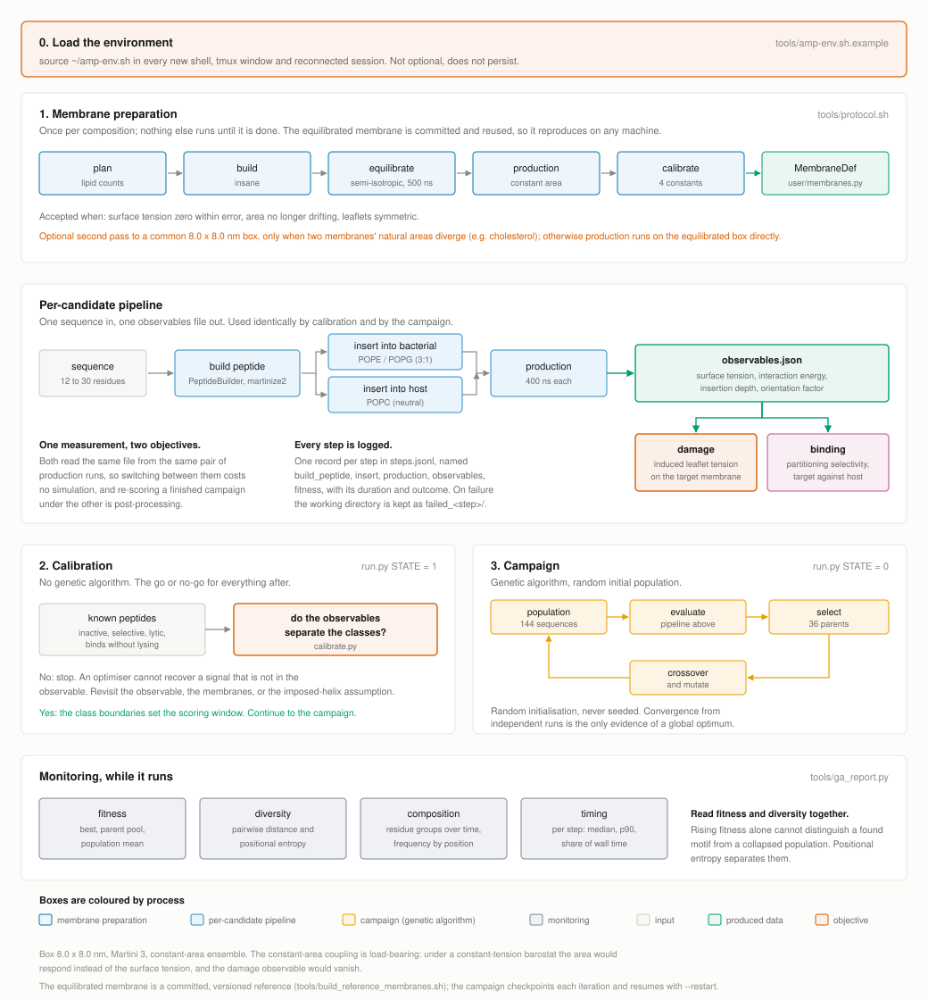

# amp-evomd

Physics-based design of antimicrobial peptides by embedding coarse-grained molecular dynamics
in a genetic algorithm.

Adapted from the Evo-MD code of van Hilten, Methorst, Verwei and Risselada
(Sci. Adv. 2023, 9(11), eade8839, DOI 10.1126/sciadv.ade8839), which optimised curvature
sensing peptides. The genetic algorithm, the GROMACS wrappers and the simulation scaffolding
are theirs. What changed is the axis of comparison and the objective.



## What problem this addresses

The original compares one membrane composition held at two areas, and measures how much the
peptide reduces the work needed to stretch the leaflet. That difference is curvature sensing.

Here the axis is composition rather than tension: one bacterial membrane mimic and one host
mimic, both at constant area. The same measured quantity means something different on that
axis, and two objectives are built from it.

| | original | this fork |
|---|---|---|
| compared | two tension states of one membrane | two compositions |
| ensemble | constant area | constant area, unchanged |
| measured | surface tension, insertion depth | surface tension, insertion depth, peptide-lipid interaction energy |
| objective | curvature sensing free energy | induced leaflet strain (damage), or partitioning selectivity (binding) |

### The two objectives

Both read the same `observables.json`, produced by the same pair of production runs. Switching
between them costs no simulation, and re-scoring a finished campaign under the other is a
post-processing step rather than a second campaign. That is the reason they live in one
repository.

**damage** maximises `delta_gamma` on the target membrane, with a hinge penalty on the host.
`delta_gamma = gamma(free) - gamma(with peptide)` at constant area, so a positive value means
the peptide relieves tension in the leaflet it occupies, which is the same statement as the
peptide generating leaflet strain. This is a damage observable rather than a binding one: the
mechanical reading in the source paper is that a peptide which senses leaflet tension also
induces it, and that membrane-binding peptides therefore lower the energetic cost of the
curved interface of a toroidal pore. Curvature selectivity needed the derivative of this
quantity with respect to area; damage does not, so one area state suffices.

**binding** maximises a partitioning proxy on the target relative to the host. The proxy is
configurable because it should be chosen from the calibration run rather than assumed. None of
the options is the quantity one actually wants, which is the partitioning free energy by
thermodynamic integration; that does not fit inside the loop and is reserved for re-ranking the
survivors, exactly as in the source paper. `BINDING_proxy` is either `interaction_energy` or
`depth`; `combined` is refused at startup because it z-scores a candidate against its own
generation and nothing in the pipeline collects the statistics that needs.

Both objectives are gated on the **orientation factor** (Eq. 3 of the source paper), a number in
[0, 1] measuring whether the peptide was at the interface at all. Two properties of it are worth
knowing, because both were wrong and both were invisible:

It is averaged over frames, not evaluated at the mean insertion depth. The cosine window is
symmetric about the reference depth `b`, so a peptide that spends half the window buried between
the leaflets and half dissolved in water has a mean depth of almost exactly `b`. Evaluated at
that mean it scores 1.0, the maximum possible weight, for a trajectory that was never at the
interface.

Below `ORIENTATION_reject_below` the candidate is rejected rather than scaled, at
`DETACHED_FITNESS`. Scaling cannot express what a low factor means. The factor multiplies only a
positive score, so a detached peptide scored exactly 0.0 and, on a maximised fitness, 0.0 beats
every attached peptide whose `delta_gamma` is negative. In early generations most random
sequences are in that position, so detaching was worth more than most honest attempts and the
fitness trace would have shown only a plateau at zero. A rejected candidate is not a penalised
measurement; it is a statement that the measurement does not mean what the objective assumes.

### What carries over from the source paper, and what does not

The transferable asset is not the fitness function, which is specific to curvature. It is:

1. Physics-based fitness inside a genetic algorithm is affordable only if the observable is a
   cheap readout. In the original it is a single `gmx energy` call on the surface tension, not
   an alchemical calculation. That ceiling constrains every choice of observable here.
2. Maximising a single physical observable returns its degenerate extreme, not a usable
   peptide. The source paper set out to optimise curvature sensing and obtained the optimal
   binder: a sequence so hydrophobic it would aggregate out of solution. The analogous failure
   here differs by objective. Maximising damage reproduces the hydrophobic extreme directly.
   Maximising binding selectivity does not, because hydrophobic insertion raises affinity for
   both membranes and largely cancels in the difference, leaving electrostatic discrimination;
   its extreme is instead a maximally cationic peptide, selective, weakly potent and
   salt-sensitive. A different failure, still a failure.
3. The useful regime is therefore a window on the objective, and the window has to be
   calibrated against peptides whose behaviour is known experimentally. Without that
   calibration the output is a ranking without a scale.

### Relation to Evo-MD-FE

Biriukov and Vacha (2026, reference 2 below) independently adapted the same Evo-MD lineage to a
bacterial membrane, optimising peptides that reduce the line tension of a membrane pore. Their
work overlaps this one and bounds what is left to do here, so the differences are worth stating
precisely rather than discovering later.

They model an effectively infinite toroidal pore as a lipid stripe, take the box size along the
rim as a collective variable, and obtain the line tension from the slope of the free-energy
profile over three umbrella-sampling windows. Their fitness is the relative reduction of that
line tension. The cost is comparable to the two production runs used here, which disposes of the
assumption that pore energetics are too expensive for a genetic algorithm: what was missing was
the collective variable, not the compute.

What does not transfer, and why:

- Their headline result is that the best line-tension reducers carry a negatively charged polar
  face, with lysine almost absent among top performers. That result was obtained with a hybrid
  Martini 2.2 model using polarisable water, chosen specifically because line tension requires
  it. Charge-related conclusions are the ones most sensitive to the water model, and this fork
  keeps Martini 3 with non-polarisable water, so the result is not imported as a prior.
- Their aromatic-terminal motif is strongly positional: cyclic shifts of their best sequence that
  preserve composition and helical-wheel arrangement all performed worse. The mechanism they
  propose is specific to the pore rim, where aromatic ends anchor both helix ends and align the
  peptide parallel to the membrane edge. The geometry here is a flat bilayer with no rim, so the
  selective pressure that produced the motif is absent and the motif is not encoded as a
  constraint. Whether it emerges anyway from an unconstrained run is a result either way.
- They report that two model curvature-sensing peptides showed no appreciable line-tension
  reduction. This is a direct challenge to the premise of the damage objective here, which treats
  induced leaflet strain as a damage proxy. Pore formation and pore stabilisation may simply be
  different steps, weakly correlated or anticorrelated. The calibration run settles it cheaply.

What this fork adds is the step their conclusions leave open: they simulate peptides already
placed at the pore rim, so membrane recruitment and selectivity are not part of the calculation,
and they flag explicitly that whether their anionic peptides can target an anionic membrane
remains to be established. Recruitment against a host membrane is what the binding objective here
measures. The tension between the two steps, cationic for recruitment and anionic for pore-rim
stabilisation, is the interesting part rather than a contradiction to resolve.

Adopted from their methodology, all of it force-field independent: neutral peptide termini
(`martinize2 -nt`, since charged termini add an orientation-dependent contribution to the
measured surface tension that has nothing to do with the sequence), explicit physiological salt
in the membrane build, and the exclusion of isoleucine on the grounds documented in
`user/usersettings.py`. Replicate evaluations per candidate are not yet implemented; the genetic
algorithm's rerun averaging covers only the elites.

## Order of work

The calibration run comes first, and it uses no genetic algorithm.

0. **Run the dry run once.** `python tools/dryrun.py` exercises every step below on a system
   small enough to finish in about twelve minutes, so that the first thing a long run tests is
   the science rather than the installation. See [The dry run](#the-dry-run).
1. **Build and calibrate the membranes.** Each composition needs its own reference
   measurements, taken on the peptide-free membrane: box area, free-membrane surface tension,
   and bilayer thickness. These are not transferable between compositions. The procedure is
   documented at the top of `user/membranes.py`. Until both the numbers are filled in and the
   equilibrated `.gro` and `.top` are copied into place, anything that would run a simulation
   refuses to start. Those are two separate steps and the second is the one usually missed.
   `calibrate.py` does not check either, because re-scoring an existing result set does not
   touch the membranes.
2. **Measure the calibration set.** Copy `seq.txt.example` to `seq.txt` and fill it with a few
   dozen peptides with known MIC and haemolysis, then run `STATE = 1` in `run.py`. Prioritise
   coverage of the regimes over potency: an inactive peptide and a non-selective lytic one are
   what fix the ends of the scale, and a binding-without-lysis control is what tests whether the
   damage observable is measuring what it claims.
3. **Check whether the observables separate the classes.** `calibrate.py` scores those results
   under either objective and reports pairwise concordance against the labels. This is the
   go/no-go: an optimiser cannot recover a signal that is not in the observable.
4. **Only then run a campaign.** `run.py` with `STATE = 0`.

## Installation on an Ubuntu workstation

Two situations, with different first steps. Pick the one that matches the machine.

- **A: you have `sudo`.** Install the system packages, then continue from step 2.
- **B: you do not have `sudo`, and GROMACS comes from a module.** The common lab and cluster
  case. Skip to "Installing without root" below, then continue from step 2.

Everything after step 1 is identical in both cases and needs no root.

### 1A. System packages, with sudo

```bash
sudo apt update
sudo apt install -y build-essential git python3 python3-pip python3-venv \
                    gromacs libopenmpi-dev openmpi-bin
```

Ubuntu's `gromacs` package installs the binary as `gmx` and is fine for this pipeline. If the
lab has its own GROMACS build, use that instead and skip the `gromacs` package: a source build
is typically 2 to 3 times faster because it is compiled for the machine's own instruction set,
which matters a great deal across thousands of evaluations. A source build with MPI usually
installs the binary as `gmx_mpi` rather than `gmx`; see the `GMX` variable below.

### 1B. Installing without root

Nothing in this pipeline needs to be installed system-wide. The three things `apt` would have
provided are a GROMACS binary, an MPI library, and a Python with `venv`, and on a machine with
environment modules the first two normally come from modules while the third is usually already
present.

**Find and load the modules.** The exact names vary by site, so list them rather than guessing:

```bash
module avail 2>&1 | grep -i -E "gromacs|gmx"
module avail 2>&1 | grep -i -E "openmpi|mpich|mpi|python"
```

Load GROMACS **with an explicit version**, and note whether it brings MPI with it:

```bash
module load gromacs/2024.3     # the exact name and version 'module avail' printed
which gmx gmx_mpi
gmx --version | head -20       # or gmx_mpi --version
```

Name the version. A bare `module load gromacs` resolves to whatever the site has set as the
default, and administrators change that default without announcing it. Intending to use one
version is not the same as having used one, which is what the pinning below makes checkable.

The lines to read are `GROMACS version` (anything from 2021 onward works) and `GPU support`,
since CUDA support cuts the per-candidate cost substantially. If the binary is `gmx_mpi`, set
`export GMX=gmx_mpi` later; the pipeline reads that variable rather than assuming a name.

**Put the module loads in a file, and source that file, rather than putting them in
`.bashrc`.** A ready-made one ships with the repository:

```bash
cp ~/AMP-evo-MD/tools/amp-env.sh.example ~/amp-env.sh
nano ~/amp-env.sh          # edit the three marked lines at the top
```

The three lines are the clone path, the exact GROMACS module name, and the binary name (`gmx` or
`gmx_mpi`). Everything else is handled: it checks the module actually loaded, confirms the binary
is on `PATH`, reads the version from the binary itself rather than trusting the module name,
activates the virtual environment, and sizes the MPI ranks and threads for the machine.

Load it before working, in every new shell:

```bash
source ~/amp-env.sh
```

It prints what it set, so you can see at a glance which environment a terminal is in:

```
amp-env loaded
  root              /home/madson/AMP-evo-MD
  gmx               /opt/gromacs/2024.3/bin/gmx
  gmx version       2024.3  (pinned as 2024.3)
  python            /home/madson/AMP-evo-MD/.venv/bin/python3
  MPI ranks         15
  threads per rank  2
```

**Do not put the contents in `~/.bashrc`.** It runs in every shell you open on that machine:
`module purge` would drop the modules of any other work you have loaded, activating the
virtualenv would make every `python` on the machine this project's python, and the core detection
would spawn a subprocess on every shell start, which on a networked filesystem is slow enough to
notice over ssh. The failure mode is worse than the cost: if the site's module default changes,
`tmux` sessions opened before the change keep the old environment while new ones get the new one,
and you end up with half a campaign from each build. Loading the environment should be deliberate
and visible in the shell you did it in.

For convenience, put only an alias in `~/.bashrc`:

```bash
echo "alias ampenv='source ~/amp-env.sh'" >> ~/.bashrc
```

Then `ampenv` loads it and the rest of the machine stays untouched.

`GMX_VERSION_EXPECT` pins the build. `run.py` checks the running GROMACS against it at the start
of both the campaign and the calibration run, and stops with a clear message on a mismatch, rather than producing numbers that silently do not
belong with the rest of the campaign. Matching is a prefix test, so `2024` accepts any 2024.x
and `2024.3` does not accept `2024.4`. Leave it unset and the version is recorded but not
enforced.

**If `python3 -m venv` is unavailable.** Some minimal installs ship Python without `venv`. Check
first, since this is usually a non-problem:

```bash
python3 -m venv --help >/dev/null 2>&1 && echo "venv ok" || echo "venv missing"
```

If it is missing, install a complete Python into your home directory with micromamba. It is a
single static binary, needs no root, and does not touch anything outside `~/micromamba`:

```bash
cd ~
curl -Ls https://micro.mamba.pm/api/micromamba/linux-64/latest | tar -xvj bin/micromamba
./bin/micromamba shell init -s bash -p ~/micromamba
source ~/.bashrc
micromamba create -y -n amp python=3.11
micromamba activate amp
```

With micromamba active, use `micromamba activate amp` wherever the steps below say
`source .venv/bin/activate`, and skip the `python3 -m venv` line.

**MPI without root.** `pip install mpi4py` now ships a binary wheel, and that wheel does not
bundle an MPI library: it links dynamically against `libmpi.so.40` (OpenMPI) or `libmpi.so.12`
(MPICH) and picks whichever it finds at import time. So as long as a module provides one of
those, the wheel works with no compiler and no root. Verify after installing:

```bash
python -c "from mpi4py import MPI; print('MPI ok, size =', MPI.COMM_WORLD.Get_size())"
```

If that fails with `libmpi.so.* not found`, load an MPI module (`module load openmpi`) and try
again. If it still fails, the site's MPI has an incompatible soname, and the fallback is to
compile mpi4py against it:

```bash
export MPICC=$(which mpicc)
pip install --no-binary=mpi4py --force-reinstall mpi4py
```

That needs a compiler, which a `gcc` module usually provides. And if none of this works, the
pipeline still runs: `mpi4py` is optional throughout, and both the campaign and the calibration
set fall back to a single process. It is slower, not blocked.

### 2. Python environment

A virtual environment, never the system Python. Nothing here is pinned, but `vermouth` and
`PeptideBuilder` pull in versions that are better kept isolated, and on a shared machine you
would not be able to install them system-wide anyway.

```bash
git clone https://github.com/madsondeluna/AMP-evo-MD.git
cd AMP-evo-MD

python3 -m venv .venv            # or: micromamba activate amp
source .venv/bin/activate

pip install --upgrade pip
pip install numpy matplotlib vermouth PeptideBuilder
pip install mpi4py               # optional, see 1B; everything runs serially without it
```

`vermouth` provides the `martinize2` command that converts an atomistic peptide into its
coarse-grained topology. Confirm everything is reachable:

```bash
python -c "import numpy, matplotlib, PeptideBuilder; print('python deps ok')"
python -c "from mpi4py import MPI; print('MPI ok')" || echo "no MPI: serial only, fine"
martinize2 --version
```

If `pip` cannot reach the network on a locked-down machine, download the wheels on a machine
that can and copy them over:

```bash
# on a machine with network access, matching the target's Python version:
pip download numpy matplotlib vermouth PeptideBuilder mpi4py -d wheels/
# then on the lab machine:
pip install --no-index --find-links wheels/ numpy matplotlib vermouth PeptideBuilder
```

### 3. insane, for building membranes

`insane.py` builds the initial lipid bilayer. It is not on PyPI, and it goes in your home
directory, so this step needs no root either:

```bash
mkdir -p ~/bin
curl -L https://raw.githubusercontent.com/Tsjerk/Insane/master/insane.py -o ~/bin/insane
chmod +x ~/bin/insane
export PATH="$HOME/bin:$PATH"
insane --help | head -5
```

Add that `PATH` line to `~/amp-env.sh` alongside the module loads, so a run always picks up the
same set of tools.

### 4. Verify the installation

The test suite runs without GROMACS, because the scoring layer is a pure function of the
observables file. Most of it takes about a second; the dry-run tests add a dozen seconds
because each runs the driver as its own process:

```bash
python -m unittest discover -s tests
```

Then exercise the reporting tools against synthetic data, which checks matplotlib and the
parsers without spending any simulation time:

```bash
python tests/make_fake_progress.py --out /tmp/fake_progress.txt
python tools/ga_report.py /tmp/fake_progress.txt --outdir /tmp/ga_report
```

That writes `performance.png`, `composition.png`, `positional.png`, `progress.csv` and
`summary.json` to `/tmp/ga_report`. If those appear, everything except GROMACS itself is
working.

Last, run the same preflight a campaign runs, which checks the external programs rather than the
Python layer. It takes about a second and needs no membranes, so it is usable before step 1:

```bash
python -c "import run; run.preflight(membranes=False)" && echo "environment ok"
```

Silence and `environment ok` mean `gmx`, `martinize2` and `PeptideBuilder` all run. Anything
missing is named, with the fix. Drop `membranes=False` once the membranes are prepared to check
their files and reference values as well.

Those three checks cover the installation. To check that the pipeline itself works end to end,
see [The dry run](#the-dry-run), which runs every step on a small system in about twelve
minutes. It is worth doing once before the first real campaign.

### 5. Environment variables

| Variable | Purpose | Default |
|---|---|---|
| `GMX` | GROMACS binary name | `gmx` |
| `GMX_VERSION_EXPECT` | pin the GROMACS version; runs stop on a mismatch | unset, version recorded but not enforced |
| `MARTINIZE2` | martinize2 binary | `martinize2` |
| `OMP_NUM_THREADS` | threads per GROMACS process | set it explicitly, see below |

A complete `~/amp-env.sh` for a machine with modules and no root:

`tools/amp-env.sh.example` sets all of these. Copy it to `~/amp-env.sh`, edit the three marked
lines, and `source ~/amp-env.sh` at the start of every session. It also exports `AMP_NP`, the
rank count the commands below use.

### Provenance: what actually ran

Every campaign records the GROMACS version and banner, the martinize2 and Python package
versions, and the loaded module list in the header of its progress file. Every candidate records
the GROMACS version in its own `observables.json`, so a single result is self-describing and a
later re-score does not depend on trusting a note about which build was loaded.

`calibrate.py` warns when a set of results was produced by more than one build and reports how
many candidates came from each. This matters because surface tension is sensitive to the build:
a version change shifts the values in a way that looks exactly like a real effect of the
sequences, and nothing else in the output would reveal it.

Check what a finished run used:

```bash
head -40 campaign_damage/output.txt                     # the campaign header
python -c "import json; print(json.load(open('campaign_damage/KWLRK.../observables.json'))['_provenance'])"
```

## The dry run

Before committing a workstation to a campaign that runs for days, run the whole pipeline small.
`tools/dryrun.py` has every step the real thing has, on a system that finishes while you watch:

```bash
source ~/amp-env.sh
python tools/dryrun.py
```

It calls `tools/protocol.sh` for the membranes and `run.py`'s own modules for the candidates
rather than reimplementing either, because a smoke test that exercises different code than
production proves nothing about production. What it shrinks:

| | dry run | production |
|---|---|---|
| box | 6.0 x 6.0 nm | 8.0 x 8.0 nm |
| membranes | 2, one target one host | same |
| membrane runs | 1 ns equilibration, 1 ns production | 200 ns and 400 ns |
| candidate runs | 1 ns | 400 ns |
| peptide length | 12 residues | 24 |
| campaign | 4 candidates, 2 iterations | 144 candidates, 100 iterations |
| averaging window | last 50 percent | last 5 percent |

Roughly twelve minutes on eight cores. Nothing is written into the repository: the membranes it
builds go into the working directory, so a dry run cannot overwrite a prepared membrane, and the
settings are shrunk in memory rather than by editing `user/usersettings.py`.

**The numbers it produces are not usable.** The box is small, the runs are short, and the
averaging window is widened to compensate, so the surface tension is nowhere near converged.
A `MembraneDef` emitted by the dry run must never be pasted into `user/membranes.py`. The dry run
answers "does it run", not "is the answer right".

### What each stage checks

| Stage | Proves | Equivalent to running |
|---|---|---|
| 0 environment | `gmx`, `martinize2` and `PeptideBuilder` are reachable and report a version | the preflight every campaign runs |
| 1 membranes | a membrane can be planned, built with `insane`, minimised, equilibrated, measured, and turned into the four reference numbers | `tools/protocol.sh` |
| 2 one candidate | one sequence goes through all five modules and comes out with a score | `STATE = 1` with one sequence |
| 3 mini campaign | the GA evaluates, selects, mutates, writes a progress file and checkpoints | `STATE = 0` |
| 4 reports | the analysis tools read what the campaign wrote | `tools/ga_report.py` and `calibrate.py` |

Stage 4 matters more than its size suggests: it is normally the part that only gets exercised
days in, when there is finally something to analyse and a parsing mismatch costs a rerun.

### What you should see

Each stage prints what it is about to prove, the command it stands in for, what to expect, and
then what it actually got. The shape is fixed; the values below stand in for whatever your run
measures:

```
--------------------------------------------------------------------------------
STAGE 2  one candidate
--------------------------------------------------------------------------------
What this proves: a single sequence goes through every module of the per-candidate
pipeline and comes out with a score

Equivalent command:
  STATE = 1 in run.py, with one sequence in seq.txt

Expect:
  five steps in steps.jsonl: build_peptide, insert, production, observables, fitness
  an observables.json carrying surften, delta_gamma, e_lipids, d_mem and orientation
  a finite fitness, whose sign says whether the peptide raised or lowered the tension

  sequence                     LARKFLEKLYKQ
  steps                        build_peptide ok, insert ok, production ok, observables ok, fitness ok
  dry_target                   delta_gamma <value>, d_mem <value> nm, orientation <value>
  dry_host                     delta_gamma <value>, d_mem <value> nm, orientation <value>
  fitness                      <value>  (raw <value>)

PASS
```

What to read there is structural, not numerical: five steps all `ok`, an entry for each
membrane, and a finite fitness. The measured values are not comparable to anything at this run
length, which is why no reference numbers are given for them. The one number worth a glance is
`orientation`: a value at or near zero means the peptide left the membrane surface, which at
1 ns can happen by chance and in a real run would be a result.

The run ends with a table of stages and an explicit statement of what passing does and does not
mean.

Two things in the output look like problems and are not. Stage 1 will almost certainly warn that
the membrane is not tensionless: at 1 ns it cannot be, and that is precisely why these numbers
are not a calibration. Stage 3 may report a low acceptance rate when building the initial
population, because the charge window was tuned for 24-mers and the dry run uses 12-mers.

### When something fails

The summary names the stage, and the stage's own output names the cause. Later stages depend on
earlier ones, so the first failure is the one to read. The working directory is kept on failure
and removed on success; pass `--keep` to keep it either way.

```bash
python tools/dryrun.py --stage 1 --keep     # one stage, keeping everything it wrote
python tools/dryrun.py --from 2 --dir <dir> # resume in a directory from a previous run
```

### Without GROMACS

`--no-md` runs no simulation at all. It checks the driver, the settings overrides, the membrane
registry, the scoring layer, the genetic algorithm and the reporting tools, in a few seconds and
on any machine:

```bash
python tools/dryrun.py --no-md
```

Its value is diagnostic: it separates a broken environment from a broken pipeline. If `--no-md`
passes and the full dry run fails, the problem is GROMACS, `insane` or `martinize2` and not the
code. The summary says explicitly which claims it did not check, so it cannot be mistaken for the
real thing.

## Running it

### Step 0: load the environment, every session

Every command in the steps below assumes this has been run in the current shell:

```bash
source ~/amp-env.sh
cd ~/AMP-evo-MD
```

It is not optional and it does not persist. A new terminal, a new `tmux` window, or a reconnected
ssh session each need it again, because the modules, the virtualenv and the rank sizing live in
the shell and not on disk. The script prints what it set, so one look tells you whether a
terminal is ready.

Skipping it is the single most common way to get a confusing failure: `gmx: command not found`,
a `martinize2` from the wrong Python, or a campaign that runs on the site's default GROMACS
rather than the pinned one.

### Step 1: prepare and calibrate the membranes

Nothing else runs until this is done. `user/membranes.py` raises `UncalibratedMembrane` from
`run.py` and from the simulation modules while the reference values are missing, which is
deliberate: a plausible placeholder would propagate into every fitness value in the campaign
while looking entirely reasonable.

**Three of the lipids in the compositions below are not parameterised in the force field files
shipped here.** The Martini 3 set in `user/base/` covers the phospholipids, the ions and the
solvents; it defines neither cardiolipin (`CDL0`, `CDL1`, `CDL2`), nor sphingomyelin (`DPSM`),
nor cholesterol (`CHOL`). As written, neither the bacterial nor the host membrane can be built
without adding the parameter files that define them, which Martini distributes separately from
the main lipid set. `tools/membrane.py plan` checks this and stops with the list, before
`insane` builds a structure that `grompp` would then refuse.

Two ways forward, and the choice is a scientific one rather than a packaging one. Add the
missing parameter files, which keeps the compositions as designed: cardiolipin is what makes a
Gram-negative inner membrane mimic anionic in the way that matters, and cholesterol is the main
determinant of a host membrane's resistance to lysis, so dropping either changes what the
calibration means. Or build from the lipids that are defined and say so, accepting that the host
membrane becomes a generic neutral bilayer rather than a hemolysis proxy.

```bash
# First pass. Prints the plan and the insane command, then stops.
./tools/protocol.sh bacterial "POPE:70,POPG:20,CDL2:10" target
```

Read the plan it prints. It reports the lipid counts, the water count, the box dimensions, and
whether a 30-residue helix fits with enough clearance from its own periodic image. Stopping here
on the first pass is intentional: lipid naming and the `insane` flags differ between Martini
lipid sets, and a wrong `-l` / `-u` split produces an asymmetric bilayer that looks fine until
the surface tension refuses to reach zero.

Once the plan looks right:

```bash
AUTO=1 ./tools/protocol.sh bacterial "POPE:70,POPG:20,CDL2:10" target
```

This builds, minimises, and equilibrates at zero tension under a semi-isotropic barostat, then
measures the equilibrium area per lipid and prints a second plan with corrected lipid counts.
Rebuild with those counts, re-equilibrate, and then run the production reference:

```bash
PASS=2 AUTO=1 ./tools/protocol.sh bacterial "POPE:70,POPG:20,CDL2:10" target
```

Repeat the whole sequence for the host membrane:

```bash
./tools/protocol.sh host "POPC:60,DPSM:10,CHOL:30" host
```

Why two passes. The production runs use a constant-area ensemble, so the box must sit at the
composition's own equilibrium area. The equilibrium area per lipid is only known after
equilibrating, so the lipid count is corrected on a second pass while the box stays fixed at
8.0 x 8.0 nm. The lipid count is the free parameter, not the box, because the two membranes also
need comparable areas: `delta_gamma` is a per-unit-area quantity, and a large area mismatch
would dilute the per-peptide perturbation differently in each membrane.

Cholesterol is the composition where the first pass will be furthest off. Sterols condense their
neighbours, so a linear sum over the seed area-per-lipid values underestimates the real packing.
Expect to need the second pass more than for the bacterial membrane.

Useful overrides:

```bash
BOX=8.0 MAX_RESIDUES=30 SALT=0.15 EQUIL_NS=200 PROD_NS=400 \
    AUTO=1 ./tools/protocol.sh bacterial "POPE:70,POPG:20,CDL2:10" target
```

Check the result before trusting it:

```bash
python tools/membrane_analysis.py single --name bacterial --dir prep/bacterial
python tools/membrane_analysis.py compare --dir prep --names bacterial host
```

Three things must hold, and all three fail quietly if ignored. The surface tension must be zero
within error: the Evo-MD POPC reference sits at 1.93 +/- 0.99 bar, and a value far from zero
means the box area and the equilibrium area disagree, so every peptide would be scored against a
pre-stressed bilayer. The area must have stopped drifting. The leaflets must be symmetric,
because an area mismatch between them shows up as spontaneous curvature and contaminates the
surface tension. The script states each verdict in words rather than leaving it to be read off
a number.

Finally, paste the emitted `MembraneDef` blocks into `MEMBRANES` in `user/membranes.py`, and
copy the equilibrated structures into place:

```bash
cp prep/bacterial/bacterial_eq.gro user/base/insert_peptide/membrane_bacterial.gro
cp prep/bacterial/bacterial.top    user/base/insert_peptide/membrane_bacterial.top
cp prep/host/host_eq.gro           user/base/insert_peptide/membrane_host.gro
cp prep/host/host.top              user/base/insert_peptide/membrane_host.top

python -c "import user.membranes as m; m.require_all_calibrated(); print('membranes calibrated')"
```

### Step 2: measure the calibration set

Copy the template and fill it in, then set `STATE = 1` in `run.py`:

```bash
cp seq.txt.example seq.txt
```

One sequence per line, one-letter codes, blank lines and `#` comments ignored. The file is read
relative to the repository, not to the directory you launch from, so a campaign run out of a
scratch directory still finds it. The template explains what the set has to contain to be worth
running: four classes, several peptides each, including peptides that bind without lysing, which
is the class usually left out and the one both objectives can most easily mistake for a hit.

`WRITE_XTC` does not need changing for this. It does not control whether the trajectory is
written, only whether it is kept: `production.py` always writes the `.xtc` into the simulation's
temporary directory, which is where the insertion-depth analysis reads it from, and the flag
decides whether that file is then copied into the output directory. Set it `True` only if you
want to inspect the calibration trajectories afterwards. A campaign must have it `False`, which
`run.py` enforces, because keeping a trajectory per candidate across thousands of evaluations
fills a disk.

With MPI, using the layout `amp-env.sh` computed:

```bash
mpirun -np $AMP_NP python -m mpi4py run.py --output_dir calibration_run
```

Without MPI, the same command minus `mpirun` and the `-m mpi4py` wrapper. It runs the sequences
one after another in a single process, which is slow but not blocked, and for a calibration set
of a few dozen peptides that is a perfectly reasonable way to work:

```bash
export OMP_NUM_THREADS=$(python3 tools/cores.py --threads-per-rank 99 --export \
                         | sed -n 's/export OMP_NUM_THREADS=//p')
python run.py --output_dir calibration_run
```

### How many ranks and threads

`tools/cores.py` works this out, but the reasoning is worth knowing, because the obvious answer
is wrong in two ways.

**Count physical cores, not `nproc`.** On a machine with hyperthreading, `nproc` reports twice
the physical core count. GROMACS will place two threads on one physical core where they contend
for the same execution units, which for small coarse-grained systems is usually a net loss. The
script parses `lscpu` for the real figure and falls back to logical CPUs only when it cannot.

**Prefer many ranks over many threads.** There is no single number to set: occupancy is ranks
times threads per rank, and the split matters more than the product. This pipeline evaluates
many independent candidates, so throughput is what counts, not how fast any one simulation
finishes. A roughly 5000-particle Martini system stops scaling after a few threads, because
domain decomposition and communication overhead grow faster than the work does. Fifteen ranks of
two threads therefore completes fifteen candidates in about the time four ranks of eight threads
completes four, on about the same thirty cores. The default is two threads per rank for that reason.

On a 32-core workstation the script returns fifteen ranks of two threads, leaving one core free
for the session and one idle because thirty-one does not divide by two. To use that last core,
pass `--threads-per-rank 1`.

```bash
python3 tools/cores.py                       # explain the choice
python3 tools/cores.py --reserve 2           # leave two cores free on a shared machine
python3 tools/cores.py --threads-per-rank 1  # maximum rank count, nothing idle
python3 tools/cores.py --cores 64            # plan for a machine you are not on
```

The one core held back costs a few percent of throughput and keeps the machine usable while a
campaign runs, which on a shared workstation is not optional.

### Step 3: the go/no-go check

```bash
python calibrate.py calibration_run --objective damage --labels labels.csv
python calibrate.py calibration_run --objective binding --labels labels.csv
```

`labels.csv` has a header and two columns, `sequence,class`, where class is one of `inactive`,
`selective` or `lytic`:

```csv
sequence,class
GIGKFLHSAKKFGKAFVGEIMNS,selective
GIGAVLKVLTTGLPALISWIKRKRQQ,lytic
```

The script reports a pairwise concordance against those labels and states the reading. This is
the decision point for the whole approach: if the observable does not order peptides whose
behaviour is already known, no optimiser setting downstream recovers a signal that is not there.

### Step 4: run a campaign

Set `STATE = 0` in `run.py`, `WRITE_XTC = False` in `user/usersettings.py`, and pick the
objective:

```python
# user/usersettings.py
OBJECTIVE = "damage"      # or "binding"
```

A campaign runs for days, so it must survive a dropped SSH session. Use `tmux`, which lets you
reattach and watch, rather than `nohup`, which does not:

```bash
tmux new -s campaign

# tmux opens a fresh shell, so the environment has to be loaded again inside it.
# This is where forgetting step 0 costs the most: the campaign starts on the site
# default GROMACS and the mismatch only surfaces days later, if at all.
source ~/amp-env.sh
cd ~/AMP-evo-MD

mpirun -np $AMP_NP python -m mpi4py run.py --output_dir campaign_damage   # drop mpirun if no MPI
# detach with Ctrl-b then d
```

Reattach later from any session with `tmux attach -t campaign`. If `tmux` is not installed and
you cannot install it, `screen` is usually present, and failing both:

```bash
nohup mpirun -np $AMP_NP python -m mpi4py run.py --output_dir campaign_damage > campaign.log 2>&1 &
```

Resuming after a crash, a reboot, or a scheduler kill:

```bash
mpirun -np $AMP_NP python -m mpi4py run.py --output_dir campaign_damage \
    --restart campaign_damage/checkpoint.dat
```

Without MPI, a full campaign in a single process is likely impractical: the default is 144
candidates over 100 iterations, each candidate two 400 ns runs. Measure one candidate first
(see "Resource planning") and multiply before committing to it. If the serial rate is too slow,
the realistic options are getting MPI working, reducing the population and iteration count, or
moving the campaign to a cluster with a scheduler. The calibration set, which is what actually
has to happen first, is fine serially.

### Step 5: watch it while it runs

The report tool reads the progress file the GA appends to as it goes, so it can be pointed at a
campaign in flight:

```bash
python tools/ga_report.py campaign_damage/output.txt --outdir report_damage
```

It writes `progress.csv`, `summary.json` and three figures, and prints a summary table with a
plain-language reading of the state of the search, followed by a TIMING BY STEP table showing
where the wall time went. That table and the per-step logs it reads are described under
[Logs and diagnostics](#logs-and-diagnostics).

Read fitness and diversity together, never fitness alone. Rising fitness on its own does not
distinguish a search that found a motif from one that collapsed onto a few near-identical
survivors and stopped exploring: the two look identical on a fitness plot. Positional entropy
separates them. A real motif shows entropy falling at the positions that matter while others
stay high; premature convergence pulls every position down together. The script says which it
sees.

Re-score a finished campaign under the other objective without running anything:

```bash
python calibrate.py campaign_damage --objective binding
```

This works because `compute_observables` writes every observable from each pair of production
runs, and the two objectives are pure functions of that file. Comparing the two rankings on one
dataset is a post-processing step, not a second campaign.

### Resource planning

Per candidate, two production runs of 400 ns each on a roughly 8 x 8 x 9 nm coarse-grained
system. The exact wall time depends heavily on the build and whether a GPU is available, so
measure it rather than taking an estimate: run a single sequence through `STATE = 1` and time
it.

```bash
printf 'GIGKFLHSAKKFGKAFVGEIMNS\n' > seq.txt   # in the repository root, where run.py reads it
time mpirun -np 1 python -m mpi4py run.py --output_dir timing_test
```

Multiply that by the population size and the iteration count. A default campaign is 144
candidates over 100 iterations, which is roughly 14 400 evaluations before deduplication; the GA
reuses the stored fitness of sequences it has already simulated, so the real count is lower, but
the order of magnitude is what matters when deciding whether the workstation is the right place
to run this at all.

Disk: with `WRITE_XTC = False` each candidate leaves a few megabytes. With it on, budget
hundreds of megabytes per candidate, which is why it is only enabled for the calibration set.

## Logs and diagnostics

Every evaluation records what it did, step by step. This matters because a campaign runs for days
without supervision: when a candidate takes an hour or dies, the question is always *which stage*,
and guessing from a wall of GROMACS output is not an answer.

### Where everything lands

```
campaign_damage/
  output.txt                     the GA progress file: fitness per iteration
  checkpoint.dat                 restart state
  KWLRKAFKKLASKALQSLWSALAQ/      one directory per candidate
    steps.jsonl                  one record per pipeline step
    stdout_stderr.log            every command, with a banner between steps
    observables.json             the measurements, and which GROMACS produced them
    fitness                      the score and its components
    production_bacterial.log     mdrun log: performance, decomposition, warnings
    production_host.log
    failed_<step>/               only on failure: the working directory as it broke
```

### steps.jsonl

One JSON object per line, appended as each step finishes and flushed to disk immediately:

```json
{"event": "step", "index": 2, "seconds": 2531.4, "sequence": "KWLRKAFKKLASKALQSLWSALAQ",
 "started": "2026-10-08T14:02:11+02:00", "status": "ok", "step": "production",
 "time": "2026-10-08T14:44:22+02:00"}
```

and when a step fails, the step record followed by an abort record:

```json
{"error": "3", "error_type": "SystemExit", "event": "step", "index": 1, "seconds": 3.1,
 "status": "failed", "step": "insert", "traceback": "..."}
{"error": "3", "error_type": "SystemExit", "event": "abort", "index": 1,
 "preserved": ".../failed_insert", "step": "insert"}
```

Keys are written sorted, so a grep for a fixed substring such as `'"event": "abort"'` is stable
across versions. A candidate that completes also writes a final `{"event": "finish", ...}`.

The five step names, in order: `build_peptide`, `insert`, `production`, `observables`, `fitness`.

JSON Lines rather than a single JSON array, for two reasons that matter in practice. Every
completed record is valid on its own, so the file is readable after a crash mid-campaign and a
line truncated by a scheduler kill is simply skipped. And appending never rewrites what is
already there, so the cost does not grow with the length of the run.

### Reading the logs

```bash
# which step is each candidate on, and how long is it taking
cat campaign_damage/*/steps.jsonl | python3 -c "
import sys, json
for line in sys.stdin:
    r = json.loads(line)
    if r.get('event') == 'step':
        print('%-16s %-8s %8.1f s  %s' % (r['step'], r['status'], r['seconds'],
                                          r.get('sequence', '')[:24]))
"

# how far a given candidate got. Records are written when a step finishes, so the last
# line is the last completed step and the one in progress is the next in the order above.
# An "event": "finish" line means the candidate is done.
tail -1 campaign_damage/KWLRKAFKKLASKALQSLWSALAQ/steps.jsonl

# everything that failed, and where its intermediates were kept
grep -h '"event": "abort"' campaign_damage/*/steps.jsonl

# where the wall time went, as a table
python tools/ga_report.py campaign_damage/output.txt --outdir report --no-figures
```

That last command prints, after the fitness summary:

```
TIMING BY STEP
  step                  n  failed      total     median        p90        max   share
  production         1440       3     38.2 d     42.1 min   58.4 min    3.1 h     94%
  build_peptide      1443       0      4.1 h      9.8 s      14.2 s     41.0 s      1%
  insert             1443       0      2.2 h      5.4 s       7.1 s     22.0 s      1%

  wall time across all steps  40.6 d
  failed steps                3
  intermediates preserved for diagnosis:
    production     campaign_damage/GIGKFLHSAKKFGKAFVGEIMNS/failed_production
```

Median and 90th percentile sit beside the mean because the operational question is the tail. A
handful of candidates taking many times longer than typical is what decides whether a campaign
finishes this week, and a mean hides exactly that.

### Diagnosing a failure

Start at `failed_<step>/`. Each candidate runs in a temporary directory that is deleted when the
simulation finishes, which used to remove the intermediates at precisely the moment they were
needed; on failure that directory is now copied next to the output first, so the `.gro`, `.top`,
`.tpr` and `.mdp` files are exactly as they were when the step broke.

Then `stdout_stderr.log` in the same directory, which carries every command's output with a
banner naming the step:

```
==============================================================================
=== STEP 1: insert ===
==============================================================================
```

A single failed candidate does not stop a campaign: it is scored at the worst possible fitness
and the run continues. Ten consecutive failures do abort, because an unbroken run of them is the
setup rather than the sequences.

### What stops the run before it starts

Anything that would fail every candidate is checked once, before the first simulation, rather
than discovered inside the first one. `run.py` refuses to start without:

| Checked | Why it is fatal rather than a warning |
|---|---|
| `gmx` runs and reports a version | every candidate calls it; the version is also recorded in the campaign header |
| `martinize2` runs | the peptide cannot be coarse-grained without it |
| `PeptideBuilder` imports | the atomistic helix is built from it |
| every membrane has its four reference numbers | `delta_gamma` is a difference against them |
| every membrane's `.gro` and `.top` are on disk | these are copied in by hand after `tools/protocol.sh`, which is a separate step from pasting the numbers and easy to skip |
| the pinned GROMACS, if `GMX_VERSION_EXPECT` is set | surface tension is build-sensitive, so a campaign spanning two builds is not internally comparable |
| `WRITE_XTC` is `False` for a campaign | a kept trajectory per candidate fills a disk |
| every sequence uses the twenty standard residue codes | see below |

That last one is the only check here that guards against a wrong answer rather than a crash.
PeptideBuilder returns the **glycine** geometry for any character it does not recognise, lowercase
letters included, and raises nothing. A calibration set pasted from a FASTA download in lowercase
would therefore run to completion as a set of polyglycine helices, show no separation between the
known classes, and read as the observable having failed, which is the verdict that decides whether
the whole approach continues. Sequences are upper-cased and checked where they are read.

The same reasoning covers `tools/protocol.sh`, which checks for `gmx`, `insane`, `python3`, numpy
and matplotlib before step 1 rather than failing at the step that happens to need them, and
asserts that the `insane` command it extracts from the plan still carries its `-u`, `-l` and
`-sol` arguments. A truncated `insane` command does not fail; it builds a one-leaflet, salt-free
box that looks plausible.

### Reading an error

Failures an operator can act on are reported in one format, which says where the problem is and
what to do about it, rather than as a traceback:

```
==============================================================================
AMP-evo-MD: cannot continue

  what:  seq.txt not found
  where: /home/you/scratch/seq.txt
         (resolved from 'seq.txt' relative to the current directory /home/you/scratch)
  why:   STATE = 1 measures a fixed list of peptides whose behaviour is already known,
         one sequence per line. It is not shipped because the set is yours to choose.
  fix:   cp seq.txt.example seq.txt
         then edit it, or point SEQUENCE_FILE in run.py elsewhere
==============================================================================
```

`where` is the part worth reading first: for a file it gives the absolute path and, when the path
was relative, the directory it was resolved against, since running from the wrong directory is the
most common cause. For a residue name or a malformed line it gives the file and the line.

A GROMACS command that exits non-zero now reports the command, the log it wrote to, and the last
lines of that log, which is usually enough to diagnose without opening anything:

```
==============================================================================
A command exited with status 1.
  command: gmx grompp -f npt.mdp -c system.gro -p system.top -n index.ndx -o npt.tpr
  stdout:  /path/to/campaign/KWLRKAFKKLASKALQSLWSALAQ/stdout_stderr.log
  last lines of that output:
    Fatal error:
    Group Lipids not found in index file
==============================================================================
```

A traceback still means a bug in this repository rather than something to fix in the setup, and
is left alone deliberately: dressing one up as an operator error would hide it.

## Troubleshooting

**Start here for anything that happens during a run.** `steps.jsonl` in the candidate's directory
names the step that failed; `failed_<step>/` holds the working directory as it was at that moment;
`stdout_stderr.log` carries the command output under a banner for that step. See
"Logs and diagnostics" above. The entries below are for failures that happen before any of that
exists.

**`UncalibratedMembrane` on startup.** Expected until step 1 is complete. The exception names
which reference values are missing.

**`membrane files named in user/membranes.py are not on disk`.** The reference numbers were
pasted in but the equilibrated system was not copied into place. These are two separate steps
and doing only the first is easy; the message lists each missing path. The copy is the last
thing `tools/protocol.sh` prints when it finishes.

**`required programs are missing or not runnable`.** The preflight could not run one of `gmx`,
`martinize2` or `PeptideBuilder`, and it names which. This replaces the bare
`gmx: command not found` and `martinize2: command not found` that used to arrive from inside the
first candidate, minutes later and attributed to that candidate. For GROMACS: run `module list`
to see what is loaded and `which gmx gmx_mpi` to find the binary, then `export GMX=` whichever
exists. `module load gromacs` has to be repeated in every new shell, which is why it belongs in
`~/amp-env.sh`. For martinize2: the virtual environment is not active or `vermouth` is not
installed in it (`pip install vermouth`); if it lives elsewhere, set
`export MARTINIZE2=/full/path/to/martinize2`.

**`ImportError: libmpi.so.40: cannot open shared object file`.** The mpi4py wheel found no MPI
library to link against. Load an MPI module (`module load openmpi`) and retry. If the site's MPI
has a different soname, rebuild mpi4py against it with `export MPICC=$(which mpicc)` followed by
`pip install --no-binary=mpi4py --force-reinstall mpi4py`, which needs a compiler from a `gcc`
module. If none of that is available, run without MPI: both the campaign and the calibration set
fall back to a single process.

**`mpirun: command not found`.** No MPI in the environment. Drop both `mpirun -np N` and the
`-m mpi4py` wrapper, which only does anything under MPI, and run `python run.py ...` directly.
Raise `OMP_NUM_THREADS` to give the single GROMACS process the cores the MPI ranks would have
used.

**`Permission denied` writing anywhere.** Everything this pipeline writes goes under the clone
and the directories passed with `--output_dir`, so run it from a path you own, such as
`~/AMP-evo-MD`, and not from a shared or read-only location.

**Surface tension will not reach zero.** The box area and the composition's equilibrium area
disagree. Re-run the second planning pass with the measured area per lipid and rebuild with the
corrected lipid count. Do not proceed: every peptide would be scored against a pre-stressed
bilayer.

**Leaflets reported as asymmetric.** The `insane` `-l` and `-u` flags set the lower and upper
leaflets separately, and a wrong split is the usual cause. Rebuild with matching counts, unless
the asymmetry is intentional for an outer-membrane model.

**`gmx energy` finds no interaction-energy terms.** `energygrps` must be set in
`user/base/production/npt.mdp`. It is enabled in this fork, so a missing term means the mdp was
edited or an older `.edr` is being read. The damage objective does not need those terms, but the
binding objective does, which means a run configured for damage with `energygrps` disabled
cannot be re-scored for binding after the fact.

**A candidate is taking far longer than the others.** `tail -1 <candidate>/steps.jsonl` says
which step it is on. If it is `production`, check `production_*.log` for the mdrun performance
line and for domain decomposition warnings; a system that cannot be decomposed for the requested
thread count runs far slower without failing. The timing table from `tools/ga_report.py` shows
whether this is one outlier or the typical case.

**A campaign produced mostly worst-possible scores.** Those are failed evaluations, not bad
peptides. `grep -h '"status": "failed"' <dir>/*/steps.jsonl` lists them with the step and the
error; if they are all the same step with the same error, the fault is in the setup.

**The run prints nothing and uses no CPU, under MPI.** A rank died and the others are blocked
waiting for it. Launch with `python -m mpi4py run.py`, not plain `python run.py`: the wrapper
calls `MPI_Abort` on an unhandled exception, so the job ends with a traceback instead of hanging.
Every `mpirun` line in this file uses it.

**The run prints `initializing the genetic algorithm` and then pegs one core forever.** It cannot
build an initial population: the constraints reject every draw. This now fails after a bounded
number of attempts with the charge window, the enabled residues and the length settings in the
message. The usual cause is a `charge_range` that the residues with a non-zero `propensities`
entry cannot reach.

**`the system charge cannot be verified`.** Some molecule in the topology's `[ molecules ]` has
no matching `moleculetype` in the `#include`d itp files, so its charge counted as zero and the
total came out neutral without being neutral. Check that the membrane `.top` was copied together
with the itps it includes. Left unchecked this runs a charged periodic box, because grompp's
non-zero-charge note is inside the warning allowance.

**`residue name 'NA+' is not assigned to an index group`.** Martini 2 and Martini 3 name ions
differently (`NA+`/`CL-` against `NA`/`CL`). Add the name to `resnm_to_indexgroup_dict` in
`user/usersettings.py` with its group; the message lists the names currently known.

**The campaign stops improving early.** Look at the diversity panels before changing the
objective. If positional entropy is near zero across all positions, the population has collapsed
and the fix is a higher mutation rate or a larger parent pool. If entropy is still high, the
observable may simply not discriminate, which is what the calibration set exists to establish.

## Limitations to state rather than discover

**Imposed helix.** Martini cannot fold, so secondary structure is assigned, not predicted
(`run.py` writes an all-helix assignment). This was a mild assumption for curvature sensors,
which are helical by construction, and is a strong one for AMPs, many of which are disordered
in solution and fold only on binding. It is the first thing to revisit if the calibration set
is misranked.

**Peptide density.** One peptide in a roughly 200-lipid patch is about P:L 1:200. AMPs act
cooperatively at ratios an order of magnitude higher. `delta_gamma` here is dilute-limit,
per-peptide tension generation; extrapolating it to lysis is an assumption. Reference 2 measured
this dependence directly in their geometry and found the effect saturating at four peptides per
pore rim, which is a reason to take the single-peptide limit as a lower bound rather than a
proxy for the cooperative regime. Vestigial two-peptide support exists upstream
(`ENERGY_select_groups_Protein1` and `Protein2`) if cooperativity becomes central, at double the
cost and with a different interpretation of gamma.

**Threshold.** Generating leaflet strain is necessary for rupture, not sufficient, and nothing
in either objective knows where the rupture threshold lies. Establishing it requires long
unbiased runs or biased sampling on the top candidates, outside the loop.

**Electrostatics.** The inherited settings are `epsilon_r = 15` with reaction-field
electrostatics and non-polarisable water. Upstream also carried no salt beyond the neutralising
counterions; membranes built with `tools/protocol.sh` add 0.15 M on top of those, so that part
of the inherited setup is addressed. The water model is not: for a cationic peptide against an
anionic membrane, non-polarisable water with `epsilon_r = 15` remains the least favourable
combination, and polarisable water should be evaluated before any quantitative claim.

**Force field.** This fork keeps Martini 3, inherited from reference 1. Reference 2 chose a
hybrid Martini 2.2 model with polarisable water instead, citing a report that Martini 3 captures
peptide curvature sensing less accurately, and noting that polarisable water is needed to
reproduce membrane line tension. The observable used here is derived from exactly that physics,
so the criticism applies. Keeping Martini 3 is a deliberate choice for continuity with the method
this fork is built on, not evidence that the concern does not hold, and any quantitative claim
should address it.

**Ensemble.** The constant-area coupling in `npt.mdp` is load-bearing. Under a
constant-tension barostat the area would respond instead and gamma would be pinned near its
reference value; the damage observable would vanish. Do not change `Pcoupltype` without
replacing the observable.

**Scope.** Neither membrane includes LPS, so "bacterial" means an inner or cytoplasmic
membrane. Any claim about Gram-negative potency has to account for the outer membrane
separately. Nothing here models the cell wall, efflux, proteolysis or serum binding.

## Changes to the upstream code

Fixes to defects that would otherwise surface silently:

- `charge_correction` could only move the net charge toward zero, so a positive lower bound was
  unsatisfiable; it raised `NameError` on an exactly neutral sequence outside the window, and
  had no iteration guard. Rewritten to move in both directions and give up cleanly when the
  alphabet makes the window unreachable. Covered by `tests/test_charge_correction.py`.
- The `prod-NDX` index file was registered once and shared across membranes, with the resulting
  `ValueError` swallowed. Harmless while both membranes were identical POPC systems, wrong as
  soon as compositions differ: group names survive, atom indices do not. Now one per membrane.
- `mpi4py` was imported unconditionally in `core/system.py` and `core/genetic_algorithm.py`
  despite both guarding on `if MPI is not None`, so the package could not be imported without a
  working MPI stack. Guarded, matching the intent already in the code.
- The `Constraint` class was defined and never assigned to `ptr_constraint_function`, so the
  amphipathicity and charge constraints were dead code. Wired, and extended with a net-charge
  window and a hydrophobic-fraction cap.
- `martinize2` was invoked through an absolute path inside one author's home directory. Now
  resolved from `$MARTINIZE2`, defaulting to the one on `PATH`. A failure to run it was caught,
  printed and then ignored, so the next step raised a confusing error about a missing
  intermediate file instead; it now raises a `SimulationError` naming the real cause, which the
  retry logic recognises.
- A non-zero exit from any GROMACS or martinize2 command called `sys.exit`, so one candidate
  that could not be built ended a campaign that may have been running for days, and the loss was
  silent: the output directory simply stopped growing. A failed evaluation is now scored as the
  worst possible candidate and the run continues, with an abort after ten consecutive failures,
  since an unbroken run of them is the setup rather than the sequences.
- The averaging window was not the same on both sides of `delta_gamma`. The per-candidate value
  used the last five percent of the trajectory while the free-membrane reference used the last
  fifty, so the observable was a difference between two numbers taken over different windows and
  any residual drift stayed inside it. All three paths now read
  `UserSettings.ENERGY_init_fraction`.
- The error on the upstream fitness was propagated with the area prefactor applied to only one
  of its four variance terms:

  ```python
  ddF_err = np.sqrt(((0.5*dA)**2 * s1**2 + s2**2 + (0.5*dA)**2_missing * s3**2 + s4**2))
  ```

  The correct form is `0.5*dA*sqrt(s1**2 + s2**2 + s3**2 + s4**2)`. With their `dA` of
  7.012 nm2 the prefactor is 3.506, so three of the four contributions were understated by that
  factor in sigma. This fork computes a different quantity and does not inherit the expression,
  but anyone comparing error bars with the published work should know.
- `energygrps` was commented out in `npt.mdp`, which is why the interaction-energy terms
  referenced in the settings were never computed. Enabled; it costs no extra simulation.

Faults found by auditing the error paths. The first three produced a usable-looking number from
a broken measurement, which is the class that matters: a crash costs a restart, but a plausible
number propagates into the calibration verdict and into the campaign that verdict authorises.

- PeptideBuilder returns the **glycine** geometry for any character it does not recognise,
  including every lowercase letter, and raises nothing. A calibration set pasted from a FASTA
  download in lowercase ran to completion as polyglycine helices, showed no separation between
  the known classes, and would have read as the observable having failed. Sequences are now
  upper-cased and validated where they are read, naming the offending position.
- `_sum_terms` skipped absent keys, so a sum of no keys returned a clean `0.0` that reached the
  binding objective as a plausible zero interaction energy. The guard above it checked
  `ENERGY_group_terms` against itself, a different key set from the one the sum uses, so
  changing that setting passed the guard and zeroed the result. It now raises.
- A `moleculetype` was costed only when a later `[section]` header followed, so the last
  molecule in an itp contributed zero charge. Combined with the neutralisation path that is how
  a charged system comes out looking neutral and runs without counterions, grompp's non-zero
  charge note being inside the warning allowance. Both ends are now checked, and a total of zero
  computed while some molecule could not be costed is refused rather than trusted.
- The progress writer divided fitness by `ddF`, which is exactly `0.0` for a failed candidate.
  This was latent upstream, where a failure ended the run anyway, and became reachable with the
  failure tolerance above: one failed candidate then killed the campaign from inside a logging
  function, after the whole generation had already been simulated.
- Both population-initialisation loops were unbounded. Settings no draw can satisfy, such as a
  `charge_range` the enabled residues cannot reach, pegged a core indefinitely with no output,
  which is indistinguishable from a slow start. Bounded, and the message names the conflicting
  settings and the acceptance rate.
- `find_replen` assigned `repeat` and `new_seq` only inside its loop, so a sequence length no
  `rep_lengths` entry divides raised `UnboundLocalError` mid-campaign.
- The checkpoint was written over itself, so a kill or a full disk during the write truncated
  the only record of a campaign that may be days old. Written to a temporary file and moved into
  place, which is atomic; an unreadable one is now reported rather than raised as a pickle error.
- Under MPI an unhandled exception in one rank left the master blocked in `recv` with nothing
  printed: no traceback, no new candidates, no exit. Every documented launch now uses
  `python -m mpi4py run.py`, whose excepthook calls `MPI_Abort`.
- `check_exitcode` discarded the command string `run_command` had in hand, so the single most
  travelled error path in the pipeline reported only an exit status. It now names the command,
  the log, and the last lines of that log. `SimulationError` was raised with no message at all,
  which is what reached the step log as an empty `error` field.

Faults found by a second audit, of the code rather than of its error paths. The first three
again produced usable-looking numbers:

- A moleculetype was recorded only when a section that was neither `moleculetype` nor `atoms`
  followed it, so every molecule directly followed by the next `[ moleculetype ]` was dropped.
  That is the shape of every single-bead species: of the 18 entries in the shipped Martini 3 ion
  library 6 were parsed, and the 12 lost included `NA` and `CL`, the counterions the function
  exists to count. A system built with insane's own salt therefore computed as net charged, and
  the neutralisation step replaced solvent beads with ions it did not need, leaving **every
  production box charged under PME** with one warning line as the only trace. An earlier fix
  caught the last molecule in a file only, which is why this is stated in full: the first
  correction was incomplete and the incompleteness was not visible from the test that covered it.
- The orientation factor was evaluated at the mean insertion depth instead of averaged over
  frames, giving the maximum weight to trajectories that were never at the interface.
- The orientation factor scaled a detached candidate to 0.0, which outranks every attached
  candidate with a negative raw score. Both are described under [The two objectives](#the-two-objectives).
- `role="probe"` membranes are documented as ignored by the objectives and entered the
  orientation minimum anyway, so adding one probe at a low orientation rescaled every fitness in
  the campaign, which looks exactly like the peptides having got worse.
- `composition` meant mole fractions in the shipped entries and lipid counts in what the
  protocol emits, and the one consumer assumed counts. It is counts; the intended ratio lives in
  `notes`.
- `area_nm2` is typed in by hand, divides the work term, and was never compared against the box
  of the structure it names. A mistyped digit or a membrane rebuilt at another area made
  `delta_gamma` a difference between two unrelated states. `require_all_built` now compares them.
- Resuming with `--restart` rewrote the progress file from scratch, destroying the entire
  per-generation history of the campaign being continued. The checkpoint survived, so the run
  resumed correctly and lost only the human-readable record, which is also what
  `tools/ga_report.py` reads. The file is appended to now, and the checkpoint carries the
  iteration so resumed generations get new numbers instead of colliding with the ones they
  continue.
- `generate_new_population` had the same unbounded spin the initialisation loop had been
  hardened against, reachable on generation 50 of a campaign rather than at startup.
- Three exception types raised inside the module chain, including the one guarding a partial
  energy sum, were caught by neither handler in `run.py` and so ended a campaign over one
  candidate. They are `SimulationError` now, and `Errors.fail` raises a distinguishable subclass
  of `SystemExit` so that a misconfiguration is no longer laundered into a bad fitness score.
- `mdrun` ran in the directory the campaign was launched from, shared by every MPI rank, so the
  `step<N>b.pdb` files a constraint failure produces collided across ranks. A timed-out process
  was killed but never reaped.
- Converting constraints to bonds wrote its comment without a newline, so the first converted
  bond was commented out whenever the section did not begin with a comment of its own.

Structural changes:

- Membrane reference quantities moved from four bare globals to a registry of `MembraneDef`
  entries. An entry missing a measurement raises rather than defaulting, because a plausible
  placeholder would propagate into every fitness value in the run while looking reasonable.
- Measurement split from scoring: `compute_observables` writes `observables.json`,
  `fitness_damage` and `fitness_binding` are pure functions of it.
- Arginine enabled in the residue alphabet. Excluding it is defensible for curvature sensors
  and not for AMPs.

One upstream discrepancy is carried forward rather than resolved, and flagged in
`user/membranes.py`: the code derives the insertion reference depth as 92 percent of the
monolayer thickness, a factor that does not appear in the main text of the paper, which quotes
b as the monolayer thickness itself. The code value is kept, since it is what produced the
published results, but it is exposed as `B_FROM_THICKNESS` so it can be checked against
section S1.

Note also that `delta_gamma` is positive for a peptide that relieves tension, following the
internal convention of the original code, where fitness is maximised. The paper plots the
corresponding quantity as negative and inverts the y axis of Fig. 2B. Do not compare values
across the two without accounting for that.

Two further conventions worth knowing before comparing any number with the literature. GROMACS
reports `#Surf*SurfTen`, which is the surface tension multiplied by the number of interfaces,
and a bilayer in a periodic box has two; the factor is carried through here exactly as upstream
carried it, so the reference constants are directly comparable, but the stored `surften` is
`2*gamma` rather than `gamma`. And `delta_gamma_work` is not the `ddF` of the source paper:
theirs integrates over the area difference between two tension states, about 7 nm2, while this
is an absolute interfacial work at one area of about 64 nm2.

## Requirements

| Component | Needed for | Notes |
|---|---|---|
| Python 3.8 or newer | everything | |
| GROMACS 2021 or newer | all simulation | from `apt`, from a module, or a source build; the binary name is read from `$GMX` |
| `numpy` | observables, analysis | |
| `matplotlib` | figures | analysis only, not needed to run a campaign |
| `vermouth` (`martinize2`) | coarse-graining peptides | |
| `PeptideBuilder` | atomistic helix construction | |
| `insane` | building membranes | not on PyPI, fetched separately |
| `mpi4py` | parallel evaluation | optional; without it the campaign and the calibration set both run single-process |

The Martini 3 force field files are included under `user/base/`, so no separate download is
needed for those.

## Layout

```
core/                        genetic algorithm and GROMACS wrappers, from upstream
  provenance.py              records which GROMACS produced a run; added by this fork
  steplog.py                 per-step timing and outcome logging; added by this fork
  errors.py                  one format for failures an operator can act on; added by this fork
user/
  membranes.py               membrane registry and reference measurements
  usersettings.py            run configuration, objective selection
  modules/
    generate_peptide_PB.py   structure generation and coarse-graining
    insert_peptide_nmem.py   insertion into each registered membrane
    production.py            production runs
    compute_observables.py   measurement, writes observables.json
    fitness_damage.py        objective B
    fitness_binding.py       objective A
    compute_fitness.py       dispatch
  base/                      mdp files and Martini 3 force field
tools/
  protocol.sh                membrane preparation, end to end
  membrane.py                plan lipid counts, calibrate the reference constants
  membrane_analysis.py       equilibration verdict and cross-membrane comparison
  ga_report.py               campaign performance, diversity and composition
  mdtools.py                 shared parsing, statistics and plot style
  amp-env.sh.example         environment template; copy to ~/amp-env.sh and edit
  cores.py                   size MPI ranks and threads for this machine
  dryrun.py                  the whole pipeline, small, with expected outputs
docs/pipeline.svg            the diagram at the top of this file
run.py                       campaign and calibration-set entry points
seq.txt.example              template for the calibration set; copy to seq.txt
calibrate.py                 score existing results, check against known classes
tests/                       regression tests, no GROMACS required
calibration/reference_popc/  the original POPC membranes and reference energies, as provenance
```

### Which script to reach for

| Task | Command |
|---|---|
| Load the environment, every new shell | `source ~/amp-env.sh` |
| Size ranks and threads for this machine | `python tools/cores.py` |
| Prepare a membrane | `./tools/protocol.sh <name> "<composition>" <role>` |
| Check a membrane is usable | `python tools/membrane_analysis.py single --name X --dir prep/X` |
| Compare membranes | `python tools/membrane_analysis.py compare --dir prep --names bacterial host` |
| Measure known peptides | `run.py` with `STATE = 1` |
| The go or no-go check | `python calibrate.py <dir> --labels labels.csv` |
| Run a campaign | `run.py` with `STATE = 0` |
| Watch a campaign | `python tools/ga_report.py <dir>/output.txt --outdir report` |
| See which step a candidate is on | `tail -1 <dir>/<SEQUENCE>/steps.jsonl` |
| Re-score under the other objective | `python calibrate.py <dir> --objective binding` |

## References

1. van Hilten, N.; Methorst, J.; Verwei, N.; Risselada, H. J. Physics-based generative model of
   curvature sensing peptides; distinguishing sensors from binders. *Science Advances* **2023**,
   9 (11), eade8839. DOI [10.1126/sciadv.ade8839](https://doi.org/10.1126/sciadv.ade8839)

   The method and the code this fork is built on. Cite this when using the pipeline. Their Evo-MD
   and CNN code and datasets are at [zenodo.org/record/7380110](https://zenodo.org/record/7380110);
   the Evo-MD source is at
   [github.com/nvanhilten/Evo-MD_curvature_sensing](https://github.com/nvanhilten/Evo-MD_curvature_sensing).

2. Biriukov, D.; Vacha, R. Peptide Sequence Features that Reduce Membrane Pore Line Tension.
   *bioRxiv* **2026**, posted 10 September 2026, v1.
   DOI [10.64898/2026.09.06.749768](https://doi.org/10.64898/2026.09.06.749768)

   Preprint, not peer reviewed. The nearest prior work: the same Evo-MD lineage applied to a
   bacterial membrane with a pore line-tension objective. Their design decisions and their open
   questions shaped several choices here; see "Relation to Evo-MD-FE" above. Their code and files
   are to be released on Zenodo following peer review and were not available when this was
   written.
